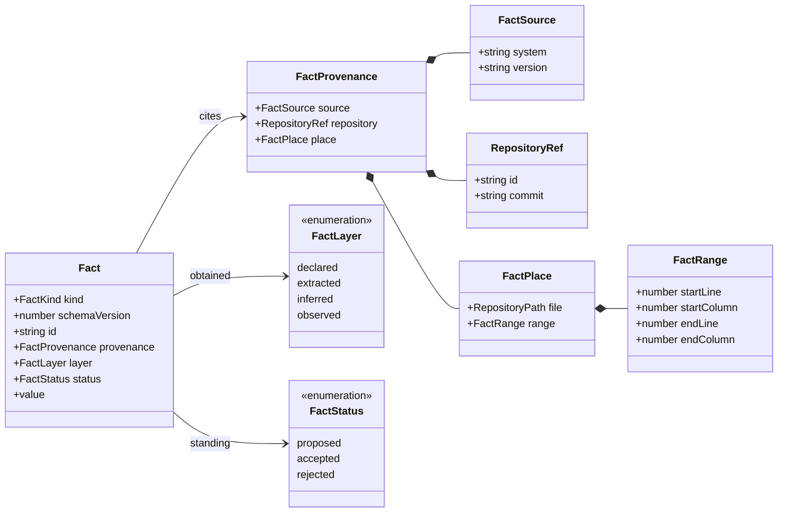
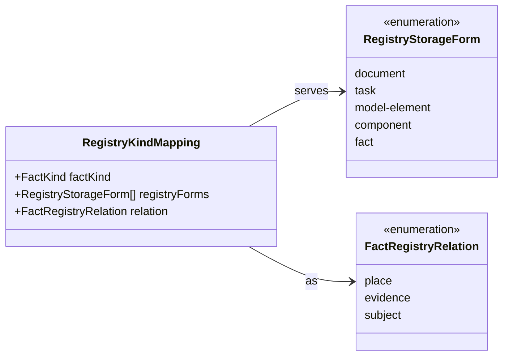

# Design of the code-fact schema

## The shape

One fact is one assertion: the kind, the version of the kind's value, the id,
the provenance, the layer and the status, and the kind's own value. The id is
the digest of the kind's identity parts and nothing else, so it can be
computed before anything is stored and checked after anything is written.

## The node kinds

Each node class shows the parts of its identity — the parts its id digests.
Everything else its value carries (a file's roles and byte count, a symbol's
signature, a claim's text) may change without changing the fact's id.

```mermaid
classDiagram
  direction LR
  class NodeFact
  NodeFact <|-- Snapshot
  NodeFact <|-- Repository
  NodeFact <|-- Directory
  NodeFact <|-- File
  NodeFact <|-- Package
  NodeFact <|-- DeployUnit
  NodeFact <|-- ApiEndpoint
  NodeFact <|-- Table
  NodeFact <|-- Column
  NodeFact <|-- EnvironmentVariable
  NodeFact <|-- Symbol
  NodeFact <|-- Occurrence
  NodeFact <|-- EntryPoint
  NodeFact <|-- Comment
  NodeFact <|-- Test
  NodeFact <|-- Module
  NodeFact <|-- Document
  NodeFact <|-- Section
  NodeFact <|-- Commit
  NodeFact <|-- Claim
  NodeFact <|-- EntityProposal
  NodeFact <|-- Rule
  NodeFact <|-- State
  NodeFact <|-- Coverage
  NodeFact <|-- Question
  class Snapshot {
    repository
    commit
  }
  class Repository {
    repository
  }
  class Directory {
    repository
    path
  }
  class File {
    repository
    path
  }
  class Package {
    repository
    form
    name
  }
  class DeployUnit {
    repository
    form
    name
  }
  class ApiEndpoint {
    contract
  }
  class Table {
    repository
    name
  }
  class Column {
    repository
    table
    name
  }
  class EnvironmentVariable {
    name
  }
  class Symbol {
    repository
    file
    qualifiedName
    symbolKind
    disambiguator
  }
  class Occurrence {
    symbol
    repository
    file
    range
  }
  class EntryPoint {
    repository
    file
    form
    name
  }
  class Comment {
    repository
    file
    range
  }
  class Test {
    repository
    file
    name
  }
  class Module {
    repository
    parent
    name
  }
  class Document {
    repository
    path
  }
  class Section {
    repository
    document
    anchor
  }
  class Commit {
    repository
    commit
  }
  class Claim {
    subject
    predicate
    object
    repository
    file
    range
  }
  class EntityProposal {
    repository
    proposed
    name
  }
  class Rule {
    subject
    statement
    repository
    file
    range
  }
  class State {
    repository
    machine
    name
  }
  class Coverage {
    repository
    scope
    reader
  }
  class Question {
    repository
    type
    about
    prompt
  }
```

The kinds the deterministic stages write (0 to 7): `snapshot`, `repository`,
`directory`, `file`, `package`, `deploy-unit`, `api-endpoint`, `table`,
`column`, `environment-variable`, `symbol`, `occurrence`, `entry-point`,
`comment`, `test`, `module`, `document`, `section`, `commit`. The kinds the
agent stages write (8 to 13): `claim`, `entity-proposal`, `rule`, `state`,
`coverage`, `question`. `module` is written by both — stage 5 clusters
deterministically, stage 9 refines the boundaries — and `coverage` by every
stage.

A `snapshot` and a `commit` name the same commit and answer different
questions: the snapshot is the pin the stages 0 to 7 read from — the tree, its
file count, its byte count — and the commit is the history node stage 7 reads:
its author, its time, its subject and the task keys it commits.

Two decisions are worth naming. An endpoint's identity is its normalized
contract id (0003) and an environment variable's is its name (0006), so the
one repository that provides and the other that consumes it are one node of
the graph. A file's identity is its repository and its path, not its commit:
a file is one node through its whole history, and what was read at a commit
is the fact's provenance, kept per version by the fact log (0009). A coverage
is one reader's reading of one scope, so its reader's name is identity too —
two stages reading one scope keep their own gaps rather than overwriting each
other's — while a state is one machine of one repository, so the same machine
name in two repositories is two machines.

## The edge kinds

```mermaid
classDiagram
  direction LR
  class EdgeFact
  EdgeFact <|-- Contains
  EdgeFact <|-- Defines
  EdgeFact <|-- Import
  EdgeFact <|-- Dependency
  EdgeFact <|-- Call
  EdgeFact <|-- Reference
  EdgeFact <|-- Inherits
  EdgeFact <|-- Provides
  EdgeFact <|-- Consumes
  EdgeFact <|-- Binds
  EdgeFact <|-- Resolves
  EdgeFact <|-- DocumentLink
  EdgeFact <|-- TaskKey
  EdgeFact <|-- Transition
  EdgeFact <|-- Interaction
  class Contains {
    from
    to
  }
  class Defines {
    from
    to
  }
  class Import {
    from
    to
  }
  class Dependency {
    from
    to
    basis
  }
  class Call {
    from
    to
  }
  class Reference {
    from
    to
  }
  class Inherits {
    from
    to
    form
  }
  class Provides {
    from
    contract
  }
  class Consumes {
    from
    variable
  }
  class Binds {
    variable
    environment
  }
  class Resolves {
    from
    to
  }
  class DocumentLink {
    from
    to
  }
  class TaskKey {
    from
    key
  }
  class Transition {
    from
    to
    event
  }
  class Interaction {
    caller
    callee
    form
    via
    repository
    file
    range
  }
```

`inherits` is SCIP's `Relationship.is_implementation` with the form that tells
an `extends` from an `implements`, the two relations RepoDoc's RepoKG keeps
apart. `provides`, `consumes`, `binds` and `resolves` are decision 0004's atoms
as the code and its configuration carry them; `coverage` is its sixth atom as a
node. `call`, `reference` and `inherits` are per pair of symbols rather than one
edge per mention, and the aggregated ones carry the code-point-smallest site as
their provenance, so an edge's evidence is deterministic. An import whose specifier resolves to no
node is a coverage gap, never an edge with an invented end (0026: referenced
nodes exist). Which kinds each edge's ends may be is `EDGE_END_KINDS`: a write's
"referenced nodes exist" check reads that table, and the test over it is where
the stages' own order is held — the last stage that writes an edge is at or
after the first stage that writes each kind its end may name.

## Identity

A kind's identity is a list of named parts: the fields of its own value and,
for the kinds that say `place: identity`, the place. `factId` turns the parts
into `{kind, identity}` and digests its canonical JSON (keys in code point
order, no whitespace: `canonicalJsonDigest`, the project's one canonical form),
writing `<kind>:<64 hex>`. Three rules follow and are tested:

- **A rerun is the same fact.** The commit, the source's version, the layer and
  the status are not identity: the same file read at another commit, by
  another tool version, is the same node.
- **A machine is not a fact.** Every path is a `RepositoryPath`, a branded
  string whose only constructors are `repositoryPath` (a path already in the
  form) and `repositoryPathIn` (a root and a location inside it). An absolute
  path is refused where it is made, so two checkouts of one repository cannot
  disagree about an id.
- **No run reaches an id.** A fact carries no clock reading and no run, unit,
  attempt, generation or session: the run's own records are the orchestrator's
  (0027), and the id's parts are the graph's. The check refuses an envelope key
  or a value key the schema does not name, so a run's field cannot ride along
  unnoticed either.
- **A name is one name.** A name part (a package's, a symbol's qualified name,
  a state's machine) is trimmed and its inner whitespace collapsed before it is
  digested, so stage 3's tree-sitter and stage 4's SCIP spelling one symbol the
  same way give one fact. Case and characters are kept: a name's bytes are the
  code's.

Rows that change without changing the identity — a file's byte count, a call's
count, a claim's confidence — update the node in place. Rows that change the
identity are another fact: another path, another repository, another span.

## The layers over the status

Decision 0005 keeps how a fact was obtained apart from whether it is accepted.
`statusesOfLayer` is the whole rule: a `declared` fact may be `proposed`,
`accepted` or `rejected` — a person's own words stand as they are written —
and an `extracted`, `inferred` or `observed` fact is always `proposed`,
because a person's acceptance is a record beside the fact and never a rewrite
of it. A kind declares the layers its stages obtain it in, and no kind of this
version admits `observed`: the fill watches no running system.

## The check

`checkFact` takes anything and names every reason it is not a fact of this
schema: not the first one, and not one per area. Each problem stands at its own
path from the fact's top and, where the fact cites a place, carries that
place's file and line. It reads, in this order:

- the envelope's own keys — `kind`, `schemaVersion`, `id`, `provenance`,
  `layer`, `status`, `value` — and refuses a key outside them, so a run, a
  unit, an attempt or a session cannot ride on a fact (0026: no run reaches an
  id);
- the kind, the schema version and the id's own shape;
- the layer over the status (0005);
- the provenance: the source and its version, the repository's product name,
  the commit, and the place — every reason at its own field, and a range whose
  fields do not read takes no part in a comparison that would compare it;
- the value's own fields, and no others: a field the kind's value does not hold
  is refused at its key, so a stray `runId` inside a value is refused too. The
  same rule holds inside every record a fact carries — a provenance, its
  source, its repository, the place, the range, an assertion's end, a binding's
  value and a coverage's gap — each shape has the keys it holds and no others,
  so no run id rides anywhere the check calls clean;
- the value's own repository and commit against the provenance's: one fact is
  filed under one repository at one commit;
- every path as a repository path, and every token;
- the shape of each field the kind declares as a list: a list is refused when
  it is not one (a coverage whose `read` is one string is not a coverage), a
  kind's roles hold at least one, and the shape — never the content of the
  list — decides whether it is read as names or as records;
- every closed form, one or a list, and every list of names in code point order
  with each name once, every list of records in the order and uniqueness of its
  documented key (`coverage.unread` is in code point order of `what`, each
  `what` once, and each gap's reason is one the schema names);
- the two places a fact carries a closed form inside its value (an assertion's
  ends and a binding's value);
- every identity part the kind declares, read as the form its kind gives it —
  a product's name for a repository and never a machine path, a commit, a fact
  id, one of the fill's own tokens, one of the kind's closed forms, text with
  something in it — so a part the graph cannot join is refused before any id
  is computed from it;
- and finally the id, against the digest its identity gives. Only this last
  comparison waits for the parts to read: an id computed from a part the check
  already refused would say nothing.

The rest of a write's checks need the pinned snapshot — that the cited bytes
exist and were read, that the referenced nodes exist, that the write is inside
its unit's scope — and belong to the write path of 0026, not here. `EDGE_END_KINDS`
is the part of that check the schema can carry: it names the kinds each edge's
ends may be, so the write path knows what to look up.

## The bridge to the registry

The registry's kinds are the product's vocabulary (0021); the fill's kinds are
the engine's. The only join is a table:

A document kind's `place` is the file and the sections it lives in; its
`evidence` is what a claim about it cites; its `subject` is a node such a
document may be about. `factKindsForRegistryForm` answers the reverse way, in
code point order. A registry kind is never renamed into a fact kind, and no
fact kind's name is a registry kind's.

## The requirements this schema meets

The fill's capability is proposed by change `fill-pipeline-monday` and not
closed, so this change moves no current requirement. These are the statements
this schema meets, written here in the capability template's form for the
change that closes decision 0026 to fold into the fill's capability; the
scenarios are the ones `test/fill-facts.test.ts` checks.

### kinds — Every node and edge kind the fill writes is declared once
The schema shall declare the fill's kinds in a namespace of its own, separate
from the product registry's: node kinds `snapshot`, `repository`, `directory`,
`file`, `package`, `deploy-unit`, `api-endpoint`, `table`, `column`,
`environment-variable`, `symbol`, `occurrence`, `entry-point`, `comment`,
`test`, `module`, `document`, `section`, `commit`, `claim`,
`entity-proposal`, `rule`, `state`, `coverage` and `question`; edge kinds
`contains`, `defines`, `import`, `dependency`, `call`, `reference`,
`inherits`, `provides`, `consumes`, `binds`, `resolves`, `document-link`,
`task-key`, `transition` and `interaction`. A kind's name shall be one lower-case word of
letters, digits and dashes, never a registry kind's name; each kind shall
declare whether it is a node or an edge, the stages that write it, the layers
it may be written in, how its place stands, and its own value version.

#### Scenario: a kind for everything the stages read
- Given: the stages of 0026, from the snapshot to the reconciliation
- When: the schema's table is read for every stage
- Then: each stage names at least one kind it writes, and each kind names the stages that write it, in the stages' own order

#### Scenario: a name the registry does not use
- Given: a product whose registry declares kinds named `observation`, `proposal` and `work item`
- When: the schema's kind names are compared with that registry's
- Then: no fact kind is one of the registry's names, and no fact id can be read as a registry document's id

### stages — A kind is placed by the stage that first writes it
The schema shall name, for every kind, the stages of the fill that write
facts of it (decision 0026's stages 0 to 7 and the agent stages 8 to 13), so a
run can tell what a stage is expected to produce and what an empty scope means.
A kind written by an agent stage shall be written in the agent stages only,
and a coverage shall be written by every stage.

#### Scenario: an agent kind comes from an agent stage
- Given: the kinds `entity-proposal`, `question` and `claim`
- When: their stages are read
- Then: each names only stages 8 to 13, and every agent stage is one of them

#### Scenario: every stage writes something
- Given: the fourteen stages of 0026
- When: the table is read for stages no kind names
- Then: there is none

#### Scenario: an edge and the stages its ends exist at
- Given: an edge kind and the kinds `EDGE_END_KINDS` lets its ends name
- When: the stages that write the edge are compared with the first stage that
  writes each end kind
- Then: the last stage that writes the edge is at or after it, because a stage
  produces only the kinds it declares and a write whose referenced nodes do not
  exist is refused (0026, 0027). `provides` names stage 5 because its
  providing end may be the module stage 5 clusters, and `consumes` names stage 4
  because its consuming end may be the symbol stage 4 resolves.

### provenance — Every fact cites what it was read from and where
Every fact shall carry its provenance (0004): the source system and its
version, the repository by the product's own name for it and the commit it was
read at, and the place — the file as a repository path and a half-open range of
one-based lines. The times a fact is valid and recorded at shall not be part of
the fact: they are the fact log's (decision 0009).

The place is required of every kind whose fact is read from a position in the
repository's bytes, which is 30 of the 40 kinds — every node the extractors and
the agent stages read out of a file or a manifest, and every edge they read
there. It is optional for the ten kinds a fact can be true of without standing
anywhere: `snapshot`, `repository` and `commit` (the pin, the repository and
the history node are the tree itself), `directory` and `contains` (a folder's
path is its own value and its children's sites are theirs), `module` (a cluster
spans many files), `coverage`, `entity-proposal` and `question` (a scope the
fill assembled, or a question about it), and `task-key` (its site is the commit
message stage 7 read, not a file). A test names that list, so a kind that stops
standing at a place, or starts to, is a decision made in one place.

#### Scenario: a fact without its source version
- Given: a `file` fact whose provenance names its system and no version
- When: the schema checks it
- Then: it is refused, naming `provenance.source.version`

#### Scenario: a fact that stands at a place and names none
- Given: an `occurrence` fact with no place
- When: the schema checks it
- Then: it is refused, naming `provenance.place`, and no other reason is reported

### layers — How a fact was obtained is kept apart from whether it is accepted
Every fact shall carry decision 0005's layer — `declared`, `extracted`,
`inferred` or `observed` — and its status — `proposed`, `accepted` or
`rejected`. The statuses a fact may carry shall follow its layer: a person's
acceptance is a record beside the fact, never a rewrite of it, so an
extracted, inferred or observed fact is written `proposed` and only a
declaration of the product's own words may stand `accepted` or `rejected`. A
kind shall declare the layers its stages obtain it in: `extracted` where a
deterministic stage of 0026 writes it, `inferred` where an agent stage does,
both where the kind has one of each (`module`, clustered at stage 5 and
refined at stage 9; `coverage`, reported by every stage), and `declared` too
for a claim, whose layer is a person's own words when a person declares it. No
kind of this version shall admit `observed`.

#### Scenario: an agent's acceptance
- Given: an inferred claim
- When: it is written with status `accepted`
- Then: it is refused, naming `status` and saying that acceptance is a record beside the fact

#### Scenario: a person's declaration
- Given: a claim whose layer is `declared`, the product's own words
- When: it is written with status `accepted`
- Then: it is accepted by the schema, with no reason reported

#### Scenario: a layer its stages cannot obtain
- Given: a state, which only the agent stage 12 writes
- When: it is written with layer `extracted`
- Then: it is refused, naming `layer` and saying that the stages that write the kind obtain it no other way

### ids — A fact's id is the digest of its identity and of nothing else
The id of a fact shall be content-addressed: the kind, a colon, and the
SHA-256 digest of the canonical JSON of the parts the kind declares as its
identity — never its commit, its extractor's version, its layer or its status,
and never a run, a unit, an attempt, a generation, a session or a time. The
same fact extracted twice, in two runs, on two machines, shall have one id; a
value that changes without changing the identity shall keep the id; a
different identity shall never take another's id; and an id written by hand
that is not the identity's digest shall be refused.

#### Scenario: two runs, one id
- Given: one file, read at commit `a…` by `tree-sitter@0.25.10` and at commit `b…` by `scip-typescript@0.4.1`
- When: the two facts are built
- Then: both ids are equal, and both cite the path from the repository's root

#### Scenario: a value that is not the fact
- Given: a file fact whose roles and byte count change, the path and repository unchanged
- When: it is built again
- Then: its id is the same, and a file at another path or in another repository is another id

#### Scenario: an id written by hand
- Given: a fact whose id is a well-formed digest another value produced
- When: the schema checks it
- Then: it is refused, naming `id` and the digest its identity has

#### Scenario: one scope, two readers
- Given: one module read by the structural reader and by the resolver
- When: both write their coverage of it
- Then: two coverage facts, each keeping its own gaps, and each reader's own rerun replaces only its own

### paths — A machine's checkout never reaches a fact
Every path a fact holds shall be a repository path: relative to the
repository's root, separated by `/`, with no `.` or `..` leg and no leading
separator, whatever the machine's own separator is. An absolute path, a path
above the root, a drive path and a path with an empty leg shall be refused;
the only constructors shall derive a path from a repository root and a location
inside it, or read a path already in that form.

#### Scenario: two checkouts, one fact
- Given: one repository checked out at `/opt/madarch-checkout` and at `/srv/ci/workspace/checkout`
- When: the same file is read in both
- Then: one repository path, `src/order.ts`, and one id, and neither checkout's directory appears in either fact

#### Scenario: a file outside the repository
- Given: a location `/tmp/other/src/order.ts` and a root `/opt/madarch-checkout`
- When: the path is derived
- Then: it is refused, and the refusal names both paths

### claims — An agent's assertion is a claim with a place and a standing
A claim shall be a fact of the kind `claim` carrying its subject, its
predicate, its object, the span it stands on as its own place, and its
status, with the layer saying how it was obtained. A subject shall be a node
of the graph; an object shall be a node, an address outside the repositories,
or a literal; a predicate shall be one lower-case token. Two claims with the
same subject, predicate, object and span shall be one claim, and the same
words at another span shall be two.

#### Scenario: one sentence, two spans
- Given: the claim that orders are placed by the order service, read once at lines 3 to 7 and once at lines 30 to 31
- When: both are built
- Then: two claim ids, one per span, and each claim names its own span as its place

#### Scenario: an object that is no node
- Given: a claim whose object names the form `node` and the id `not-an-id`
- When: it is checked
- Then: it is refused, naming `value.object`

### version — The schema and each kind carry a version
The schema shall carry a version, and every kind its own value version, which a
stage declares for the kinds it produces (decision 0027). Every fact shall
state the version of its kind, and a fact stating another version shall be
refused.

#### Scenario: a fact of another version
- Given: a `file` fact declaring version 2 while the kind's version is 1
- When: it is checked
- Then: it is refused, naming `schemaVersion` and the version the kind carries

### check — The schema names every reason a fact is not one it reads
The schema shall offer one check over a fact it may have been handed from
anywhere — an agent's write, a stored row, a fixture — naming every reason the
fact is not one the schema reads, each with its path from the fact's top and,
where the fact cites a place, that place's file and line: the envelope's
version and id, the kind, the provenance, the place, the layer over the
status, every identity part the kind declares and the form it reads as — a
repository's product name and never a machine path, a commit, a fact id, one
of the fill's own tokens, text with something in it — an identity part that is
empty, every path, every list of names in code point order without a repeat,
and the two places a fact carries a closed form inside its value (an
assertion's ends and a binding's value). The checks a write needs beyond these
— cited bytes existing and read at the pinned commit, referenced nodes
existing, the write inside its unit's scope — shall belong to the write path
(0026) and not to the schema.

#### Scenario: every reason at once
- Given: a fact whose place names an absolute path, whose range ends before it starts, and whose roles are out of order
- When: it is checked
- Then: every reason is named at its own path, and each carries the place's file and line

#### Scenario: a record listed twice
- Given: a coverage whose unread list holds one record twice
- When: it is checked
- Then: it is refused, naming the repeat's index

#### Scenario: a part the graph cannot join
- Given: a `file` fact whose value names the repository `/opt/madarch-checkout`, and a `dependency` fact whose end is `orders-service`
- When: they are checked
- Then: each is refused at its own field (`value.repository`, `value.to`), naming the form the part is, and no id is computed from either

### registry-mapping — The bridge to the product registry's kinds is a table
The relation between the fill's fact kinds and the product registry's kinds
shall be one explicit mapping, never one vocabulary derived from the other:
each fact kind mapped to the registry storage forms of decision 0021's
amendment (`document`, `task`, `model-element`, `component`, `fact`) whose
documents it serves, and to the role it plays for them — `place` for where a
document of the kind lives, `evidence` for what a claim about one cites,
`subject` for a node such a document may be about. Every fact kind shall be
mapped, every storage form shall be served by some fact kind, and the fact
kinds serving a form shall be answered in code point order.

#### Scenario: a document kind's place and evidence
- Given: a registry kind kept as a `document`
- When: the fact kinds serving that form are read
- Then: the mapping names `file` and `section` as its places and `claim` as what stands behind it

#### Scenario: a storage form nobody serves
- Given: the five storage forms of decision 0021's amendment
- When: each is asked for the fact kinds serving it
- Then: each answer is non-empty

### Quality requirements
- Determinism: the same fact gives the same id in every process, on every
  machine and at every commit; nothing in the schema reads a clock, a random
  source, the locale, the file system or the network.
- Size: the schema is pure data and pure functions; a kind is added by one
  table entry and one value type, and no stage's code changes to add it.
- Compatibility: the schema's kinds are versioned apart from the registry's
  kinds, so a product's registry never has to change for the engine's facts.

## What this change does not do

Storage, the database owner, a unit's draft set and its publication (0026,
0027) come after madarch-tzte.19.1. The stages that write each kind, the
extractors behind them, the clustering and the rendering of pages and diagrams
from the graph are the epic's later tasks.
