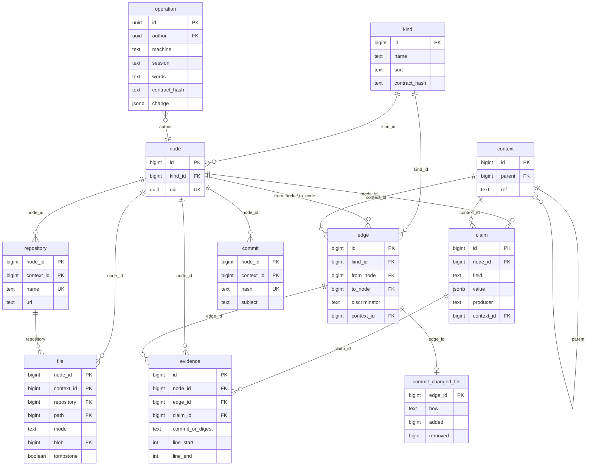

# 0034. One graph schema: identity, a table per kind from its contract, edges apart, claims with sources, layers over the parent, one journal

Status: accepted
Date: 2026-11-09

Builds on 0026 (graph first, per-file stages), 0027 (registry, orchestrator, exactly-once
publication), 0033 (one workflow, delete what is replaced) and the tracker decisions of
2026-11-08 (docs/vision/tracker-decisions-2026-11-08.md: Ent.1–Ent.3, Q1.16 sync exchanges
operations, Q1.18 snapshots are restore points). Supersedes 0028's temporal contract (valid and
recorded time on every row) and the graph of `src/graph/records.ts` as it stands at 04bcf331.
Agreed with the owner point by point on 2026-11-09 over the as-is description
(docs/system/database.md); reviewed by Codex the same day.

Amended 2026-11-09, before the implementing change merged. The first text split kinds into those
extracted from code, each with a table fixed in the engine's DDL, and those people author, sharing
one `authored` table. The owner rejected the split: «Я против выделения исключений. У нас все
сущности равны. Я думаю нужно закрепить контракт.» and «Ну конечно вид файл на появится, если его
нет в продукте. Допустим людям для проекта нужен просто трекре.» Item 14 states the rule; items
2–5, 7, 8, 10 and 13, the outline and the consequences are rewritten to it; decision 0035 says how
the tables are filled. Codex reviewed the amendment read-only; its findings are answered in the
items named in its review section.

## Context and problem

The as-is database (docs/system/database.md) holds two graphs: the fill writes the graph of
`src/graph/records.ts`, while the wiki's catalogue, entity pages and blocks read 0028's temporal
tables, which nothing writes. Every kind counts 0 and every page that showed relations is empty.
The graph that is written breaks normal form: `node.key` repeats each kind's own attribute (a
file's path, a commit's hash in all 2 440 rows, an author's email, a repository's name),
`node.repository_id` repeats the `contains` edges, and `touched`, listed as an edge kind, names a
path rather than a vertex. The old fact store is still created, the nineteen `fill_*` tables
carry no foreign key, and two components hand out work (pg-boss and the orchestrator's leases).

The owner: «Да какие старые таблицы? Я же тебе объяснил, что у нас не должно быть вторых
поверхностей»; «Да не нужен мне постепенный перевод. Удали все старые поверхности. Если тебе
понадобится код, возьмешь из истории git»; «А почему у тебя атрибуты вершины лежат в таблице с
вершинами? Это нарушение нормальной формы»; «Ну конечно давай сначала переделаем структуру БД
прежде чем чем-то заполнять».

## Decision

1. **One graph, nothing beside it.** The change that lands this schema deletes 0028's temporal
   tables (`node_identity`, `node_version`, `edge_identity`, `edge_version`, `node_kind`,
   `relation_type`, `publication_scope`, `work_item`), the old fact store (`fill_fact`,
   `fill_fact_holding`), every line that creates, writes or reads them, and the stages registered
   but not in the fill's step list. A stage comes back only as a later step that writes this
   graph; its old code is taken from git history.
2. **A vertex is identity only.** `node(id, kind, uid)`: a local id, its kind, and a stable id that
   is the same on every machine (item 10): for a kind with a natural key it is derived from the kind
   and the key (a UUIDv5 over madarch's namespace), so two machines that find the same entity give
   it the same uid; an entity with no natural key gets a random uuid when it is created. Every kind
   the product takes has its own table of attributes keyed by `node_id`, generated from the kind's
   contract (item 14), its natural key standing once there with its unique constraint. Nothing in
   `node` repeats an attribute. (Owner: «В целом твое предложение мне нравится».)
3. **A reference is a field; a relation is an edge.** A field of a contract may reference an
   entity of a named kind; it is a column holding that entity's node id, the referenced kind is
   checked on write, and it may be part of the key (a file is unique by its repository and path).
   A relation that is not a field of either end (a commit changed a file, a function calls a
   function, a story realises a goal) is an edge. A reference field is never stored a second time
   as an edge: the graph shows it as a relation computed from the column, and a neighbourhood
   query reads both. Kinds people author are not special: a story's text is a field of its
   contract, like a file's path. (Owner: «А почему это репозиторий - ребро?»)
4. **The tracker is aspects, not a family.** Lifecycle (one status, its transitions by the
   manifest's events), responsibility (responsible, executor) and accounting (work spans) are
   contracts a kind takes when the manifest attaches them, each its own table keyed by `node_id`
   (Ent.1); any kind may take them. Approval packages, questions and comments are entities linked
   by edges; blocked, pending approval and reservation are computed (Ent.3).
5. **Edges stand apart.** `edge(id, kind, from_node, to_node, discriminator)`; an edge is never a
   vertex. Each edge kind's contract names the kinds of its ends, which the write checks, whether
   repeats between the same ends are allowed (a function may call another from three places) and,
   if so, what tells them apart; `discriminator` is never null, an empty string where the kind
   does not repeat. An edge kind whose contract has attributes gets its own table keyed by
   `edge_id`, generated like a vertex kind's (a commit's change to a file: how, lines added, lines
   removed). (Owner: «Ребро должно быть в отдельной таблице».)
6. **A file is its repository and path.** A rename is an edge "renamed from" whose evidence is
   git's similarity; a path that is deleted stays a vertex, without its place in the current
   tree, and keeps its history. Git's rename detection is a similarity guess, so it never decides
   identity. A key's values never change for an entity: a different key is a different entity,
   linked by an edge where a producer says how they relate. (Owner: «Сделай как лучше».)
7. **Claims carry their sources.** Each field of a contract is marked authoritative or claimed.
   An authoritative field has one producer and is a column, written with one evidence row (what
   git states outright: path, mode, blob, size, lines). A claimed field is one tools may dispute
   (a file's language, a symbol's kind, the module a file belongs to): it has no column; each
   producer writes a claim (value, producer and version, evidence), and the entity shows the
   accepted value, computed on read by the field's rule and never copied. A key field is always
   authoritative. Evidence names a vertex, an edge or a claim, exactly one of them. Each next tool
   refines the last and every source is kept. (Owner: «Да».)
8. **Contexts are layers over their parent.** The default branch's graph stands whole; a branch
   holds only what it replaces or removes over the default branch; a worktree holds only its
   uncommitted differences over its branch, its evidence keyed by content digest. Every generated
   table, `edge` and `claim` carry the context a row belongs to; a layer's row replaces the whole
   row of its entity, edge or claim in that context, or is a tombstone that removes it, so a null in
   a layer means null and never "inherit". A read in a context takes, for each entity, the row of
   the nearest layer that has one, and drops tombstoned ones before it counts or walks. A branch's
   layer is pinned to its merge base with its parent (0033 item 26): it is read over the base as it
   stood at that commit, never over a parent that has moved on, so a change made on the parent after
   the branch left it never shows in the branch. Taking a newer base is an explicit rebase of the
   layer, which recomputes it from git's difference against the new merge base. Uniqueness holds per
   context in each table and, across the layers a read sees, is checked when a layer row is written,
   under a lock on the kind and key, against the context's effective view. A merged branch's layer
   becomes part of the base and goes. No row carries valid or recorded time. (Owner: «Да, именно
   слой отличий. git так же работает, он всегда опирается на родителя.»)
9. **The picture is current.** A file change updates its worktree's layer in the background, and
   an MCP or wiki read in a worktree first brings that worktree's changed files up to date (only
   those, through the per-file stages) and then answers. (Owner: «А почему только при коммите?
   … наш mcp должен возвращать текущую картину сразу.»)
10. **One journal for what people and the agent do.** Every create, change, status move, link,
    reservation and soft delete people or the agent make is an operation: its own id, author,
    machine, session, time, the verbatim words, its expectation, and the entities, kinds and fields
    it touches named by stable id and name with the hash of the contract they had. What the journal
    produces is told apart from what a fill derives by provenance, not by kind: the tables' rows
    that operations wrote are computed from the journal, a rebuild redoes only what is derived from
    code and never touches the journal. Ownership is per field: an authoritative field belongs to
    its one producer, and a person's or the agent's correction of it, or of a claimed field, is an
    operation kept as an overlay (0033 item 23) that wins over what plugins publish until it is
    withdrawn; suppressing an entity is such an overlay, so a plugin publishing the entity again
    does not bring it back, and the plugin's evidence is kept. A contract change is itself an
    operation, so a replay applies contract changes and data changes in their order; a contract
    change that would leave an earlier operation unreplayable (a field operations wrote, removed
    without a declared conversion) is refused. The journal is what machines exchange (Q1.16): an
    import whose contracts differ from the receiver's is applied only after the contract operations
    it carries, and refused with the kinds named where they conflict. Two machines changing the same
    field that operations wrote while apart is a conflict shown to a person, never settled silently;
    how the exchange itself is ordered belongs to the sync stage (Q1.16). With periodic snapshots it
    is the backup (Q1.18). (Owner: «Ну да, журнал транзакций получается. Мы же именно его и
    собираемся отдавать на синхронизацию.»)
11. **A signature is not a person.** A git signature (name and email exactly as a commit holds
    them) is extracted; a person and an agent are entities people author; an edge "is" links a
    signature to its person, its evidence `.mailmap`, the agent's proposal or the person's
    confirmation. A person holds their aliases (every name and where it is used: git, tracker
    actor names, chat and system accounts), the machines and sessions they and their agents work
    from, their roles per product and scope, and, by edges, the operations they performed, the
    approvals they gave and the packages waiting for them; an agent acts for its person. (Owner:
    «Какие у него есть алиасы … с какой машины? И обязательно еще нужна его роль … журнал
    операций, связанный с ним. Его согласование. Вот это все.»)
12. **One queue.** pg-boss alone hands out jobs; the orchestrator keeps generation and fence
    authority over a result and never dispatches work. Its tables reference each other by foreign
    keys on `(unit_id, generation)`; publication, its receipt, its events and the job's
    completion commit in one transaction.
13. **Dictionaries are interned values a contract declares.** A field may be of an interned type
    (a path, a content hash with its algorithm, a language name); the engine keeps one table per
    interned type a taken contract uses, each value once, and creates none a product does not
    use. The engine knows interning, not which types exist.
14. **Every kind is equal; its contract makes its table.** Every vertex kind and edge kind has a
    contract: its typed fields (each authoritative or claimed, item 7), its natural key, the kinds
    its discovery depends on (0033 item 15; the order of a fill, 0035 item 11), and for an edge kind
    its ends, whether it repeats and what tells repeats apart. madarch builds one
    attribute table per kind from its contract under a generated, stable table name (the kind's
    display name is kept apart, since names may hold spaces and PostgreSQL cuts identifiers at 63
    bytes) and migrates it when the contract changes. The engine's own DDL holds only the mechanism
    (`kind`, `node`, `edge`, claims and evidence, contexts, the journal, the queue, the fill's
    tables) and no name of a product's kind. madarch's upstream offers kinds with their contracts
    and the plugins that fill them (decision 0035), put into the product at its initialisation (all
    of them for now, a choice later); a product's manifest takes the kinds it wants and may add,
    remove or change any field of any kind, provided it names each field's producer: a plugin, a
    script, or a description the agent fills it from. A kind the manifest does not take has no
    table, and a plugin no taken kind uses does not run: a product that is only a tracker holds no
    repository, file or commit table. (Owner: «Да пусть удаляет или меняет, только пусть опишет как
    и откуда брать данные.»)
    - *Identity.* A producer names an entity by its kind and key, a reference inside a key by
      the referenced entity's kind and key; the host resolves these to node ids. One publication
      upserts referenced kinds before the kinds that reference them, in the order the contracts'
      references give; contracts whose required references form a cycle are refused when the
      manifest is read, so a cycle is broken only by a reference that may be empty and is filled
      after both ends exist.
    - *Migration.* A change of the set of contracts is validated whole before it applies: a
      field or kind still referenced by another contract, an edge kind's ends, an attached
      aspect or the journal (item 10) is refused with the dependent named; so is a change that
      would lose data or break a key on rows already held, with the kind, the field and the
      conflicting rows named. A rename is declared, never guessed from a difference. The
      migration runs in one transaction under the store's contract lock; a fill carries the
      contract version it started with, and its publication is fenced: one against an older
      version is refused and its unit runs again.

### The schema in outline

The engine's tables are fixed; `repository`, `file`, `commit` and `commit_changed_file` are
examples of tables generated from contracts a product took, not engine tables, and their names
here are the kinds' display names.

The outline names the shape, not every column; the implementing change writes the DDL and the
generator and checks them against this decision.

## Consequences

- madarch-8bdc.2.11 lands the engine's tables, the contract generator and its migrations, and
  the deletions of item 1 in one change, with the wiki's catalogue, entity pages and blocks
  reading only this graph and `/k/file` folded into the one entity page. A test asserts that no
  generated table's attribute is repeated in `node`, that the engine's DDL names no product
  kind, and that a product that takes no code kind holds no table of one; a search of the
  repository finds none of the deleted tables' names outside the decisions and change records.
- Kept from `src/graph/records.ts` (Codex's reading): change detection by key and blob, bounded
  batches, dictionary interning, snapshot reads with keyset pagination, scoped deletion
  protection reworked so a deleted file keeps its history, and explicit coverage gaps.
- The wiki's reads (a neighbourhood, a file's history, the treemap) are measured with
  `EXPLAIN (ANALYZE, BUFFERS)` on a filled product before indexes beyond the keys' and foreign
  keys' own are added.
- 0028's temporal contract is superseded: history is git plus the journal, not versioned rows.
- Later stages (imports, symbols, data model, mentions) add contracts and the plugins that fill
  them (0035); none adds engine DDL.

## Review

Codex, 2026-11-09, read-only over docs/system/database.md, `src/graph/records.ts` and the
decisions: agreed with central identity, per-kind tables by shared key, aspects for the tracker
and one queue; proposed edges as vertices (declined by the owner: item 5), rename-stable file
identity (declined: item 6), claims addressed separately from entities (taken: item 7), layered
contexts with tombstones (taken: item 8) and a journal that rebuilds never touch (taken:
item 10).

Codex, 2026-11-09, read-only over the amendment and 0035: asked that items 2–4 and 13 and the
outline lose the extracted/authored split (done: items 2–4, 13, outline), that reference fields
and edges be told apart (item 3), that layers over generated tables be defined (item 8), that the
journal carry contract versions and a replay policy (item 10), that identity resolution, upsert
order, migration dependencies and fencing be stated (item 14), and that authoritative and
claimed fields be distinguished (item 7). Its findings on plugins are answered in 0035.

Codex, 2026-11-09, read-only over the whole plan (0034 and 0035 together): asked that branch layers
not inherit a parent's later changes (item 8, pinned merge base), that plugin and journal data on
one entity compose by a stated rule (item 10, per-field ownership and overlays), and that
machine-stable identities and offline conflicts be defined (items 2 and 10). Its points on plugins,
turns and stages are answered in 0035.
