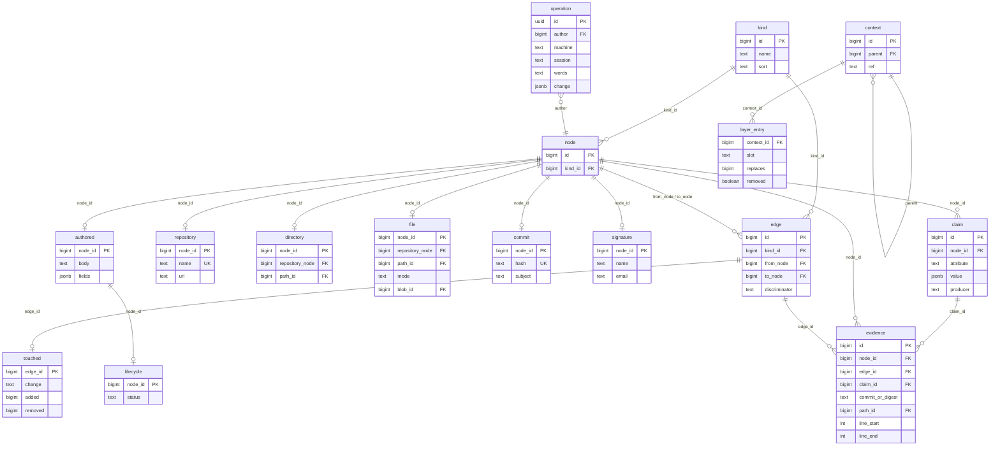

# 0034. One graph schema: identity, a table per kind, edges apart, claims with sources, layers over the parent, one journal

Status: accepted
Date: 2026-11-09

Builds on 0026 (graph first, per-file stages), 0027 (registry, orchestrator, exactly-once
publication), 0033 (one workflow, delete what is replaced) and the tracker decisions of
2026-11-08 (docs/vision/tracker-decisions-2026-11-08.md: Ent.1–Ent.3, Q1.16 sync exchanges
operations, Q1.18 snapshots are restore points). Supersedes 0028's temporal contract (valid and
recorded time on every row) and the graph of `src/graph/records.ts` as it stands at 04bcf331.
Agreed with the owner point by point on 2026-11-09 over the as-is description
(docs/system/database.md); reviewed by Codex the same day.

## Context and problem

The as-is database (docs/system/database.md) holds two graphs: the fill writes the graph of
`src/graph/records.ts`, while the wiki's catalogue, entity pages and blocks read 0028's temporal
tables, which nothing writes. Every kind counts 0 and every page that showed relations is empty.
The graph that is written breaks normal form: `node.key` repeats each kind's own attribute (a
file's path, a commit's hash in all 2 440 rows, an author's email, a repository's name),
`node.repository_id` repeats the `contains` edges, and `touched`, listed as an edge kind, names a
path rather than a vertex. The old fact store is still created, the nineteen `fill_*` tables
carry no foreign key, and two components hand out work (pg-boss and the orchestrator's leases).

The owner: «Да какие старые таблицы? Я же тебе объяснил, что у нас не должно быть вторых
поверхностей»; «Да не нужен мне постепенный перевод. Удали все старые поверхности. Если тебе
понадобится код, возьмешь из истории git»; «А почему у тебя атрибуты вершины лежат в таблице с
вершинами? Это нарушение нормальной формы»; «Ну конечно давай сначала переделаем структуру БД
прежде чем чем-то заполнять».

## Decision

1. **One graph, nothing beside it.** The change that lands this schema deletes 0028's temporal
   tables (`node_identity`, `node_version`, `edge_identity`, `edge_version`, `node_kind`,
   `relation_type`, `publication_scope`, `work_item`), the old fact store (`fill_fact`,
   `fill_fact_holding`), every line that creates, writes or reads them, and the stages registered
   but not in the fill's step list. A stage comes back only as a later step that writes this
   graph; its old code is taken from git history.
2. **A vertex is identity only.** `node(id, kind)`. Every kind extracted from code (repository,
   directory, file, commit, git signature; later symbol, import, table, column) has its own table
   of attributes keyed by `node_id`, its natural key standing once there with its unique
   constraint. Nothing in `node` repeats an attribute. (Owner: «В целом твое предложение мне
   нравится».)
3. **Authored kinds share one table.** The kinds people and the agent author (the manifest's
   catalogue: idea, user story, decision, task, person …) stand in
   `authored(node_id, body, fields)`, `fields` validated against the kind's schema in the
   product's manifest; references to other entities are edges, never ids inside `fields`. The
   engine holds no kind of its own here.
4. **The tracker is aspects, not a family.** Lifecycle (one status, its transitions by the
   manifest's events), responsibility (responsible, executor) and accounting (work spans) are
   tables keyed by `node_id`, attached per authored kind by the manifest; code kinds take none
   (Ent.1). Approval packages, questions and comments are entities linked by edges; blocked,
   pending approval and reservation are computed (Ent.3).
5. **Edges stand apart.** `edge(id, kind, from_node, to_node)`; an edge is never a vertex. Each
   edge kind declares whether repeats between the same ends are allowed (a function may call
   another from three places) and, if so, what tells them apart; an edge kind with attributes
   has its own table keyed by `edge_id` (`touched(edge_id, change, added, removed)` for commit →
   file; a parent's position for commit → commit). Belonging to a repository is an edge only.
   (Owner: «Ребро должно быть в отдельной таблице».)
6. **A file is its repository and path.** A rename is an edge "renamed from" whose evidence is
   git's similarity; a path that is deleted stays a vertex, without the edge that places it in
   the current tree, and keeps its history. Git's rename detection is a similarity guess, so it
   never decides identity. (Owner: «Сделай как лучше».)
7. **Claims carry their sources.** An attribute tools may dispute (a file's language, a symbol's
   kind, the module a file belongs to) is a claim: its value, its producer and version, and its
   evidence (repository, commit or content digest, path, lines); the entity shows the accepted
   value, computed from its claims and never copied. What git states outright (path, mode, blob,
   size, lines) stays a plain column with one evidence row. Evidence names a vertex, an edge or a
   claim, exactly one of them. Each next tool refines the last and every source is kept.
   (Owner: «Да».)
8. **Contexts are layers over their parent.** The default branch's graph stands whole; a branch
   holds only what it replaces or removes over the default branch; a worktree holds only its
   uncommitted differences over its branch, its evidence keyed by content digest. A read in a
   context lays its layers over the base; a merged branch's layer becomes part of the base and
   goes. No row carries valid or recorded time. (Owner: «Да, именно слой отличий. git так же
   работает, он всегда опирается на родителя.»)
9. **The picture is current.** A file change updates its worktree's layer in the background, and
   an MCP or wiki read in a worktree first brings that worktree's changed files up to date (only
   those, through the per-file stages) and then answers. (Owner: «А почему только при коммите?
   … наш mcp должен возвращать текущую картину сразу.»)
10. **One journal for what people and the agent do.** Every create, change, status move, link,
    reservation and soft delete of an authored entity is an operation (its own id, author,
    machine, session, time, the verbatim words, its expectation); the authored and aspect tables
    are computed from the journal; a rebuild redoes only what is derived from code and never
    touches the journal; the journal is what machines exchange (Q1.16) and, with periodic
    snapshots, the backup (Q1.18). (Owner: «Ну да, журнал транзакций получается. Мы же именно его
    и собираемся отдавать на синхронизацию.»)
11. **A signature is not a person.** A git signature (name and email exactly as a commit holds
    them) is extracted; a person and an agent are authored entities; an edge "is" links a
    signature to its person, its evidence `.mailmap`, the agent's proposal or the person's
    confirmation. A person holds their aliases (every name and where it is used: git, tracker
    actor names, chat and system accounts), the machines and sessions they and their agents work
    from, their roles per product and scope, and, by edges, the operations they performed, the
    approvals they gave and the packages waiting for them; an agent acts for its person. (Owner:
    «Какие у него есть алиасы … с какой машины? И обязательно еще нужна его роль … журнал
    операций, связанный с ним. Его согласование. Вот это все.»)
12. **One queue.** pg-boss alone hands out jobs; the orchestrator keeps generation and fence
    authority over a result and never dispatches work. Its tables reference each other by foreign
    keys on `(unit_id, generation)`; publication, its receipt, its events and the job's
    completion commit in one transaction.
13. **Dictionaries stay.** `path`, `blob`, `language` hold each value once; a blob's and a
    commit's hash name their algorithm.

### The schema in outline

The outline names the shape, not every column; the implementing change writes the DDL and
checks it against this decision.

## Consequences

- madarch-8bdc.2.11 lands this schema and the deletions of item 1 in one change, with the wiki's
  catalogue, entity pages and blocks reading only this graph and `/k/file` folded into the one
  entity page; a test asserts no kind table's attribute is repeated in `node`, and a search of
  the repository finds none of the deleted tables' names outside the decisions and change
  records.
- Kept from `src/graph/records.ts` (Codex's reading): change detection by key and blob, bounded
  batches, dictionary interning, snapshot reads with keyset pagination, scoped deletion
  protection reworked so a deleted file keeps its history, and explicit coverage gaps.
- The wiki's reads (a neighbourhood, a file's history, the treemap) are measured with
  `EXPLAIN (ANALYZE, BUFFERS)` on a filled product before indexes beyond the foreign keys' own
  are added.
- 0028's temporal contract is superseded: history is git plus the journal, not versioned rows.
- Later stages (imports, symbols, data model, mentions) each add their kind tables and edge kinds
  to this graph and nothing beside it.

## Review

Codex, 2026-11-09, read-only over docs/system/database.md, `src/graph/records.ts` and the
decisions: agreed with central identity, per-kind tables by shared key, aspects for the tracker
and one queue; proposed edges as vertices (declined by the owner: item 5), rename-stable file
identity (declined: item 6), claims addressed separately from entities (taken: item 7), layered
contexts with tombstones (taken: item 8) and a journal that rebuilds never touch (taken:
item 10).
