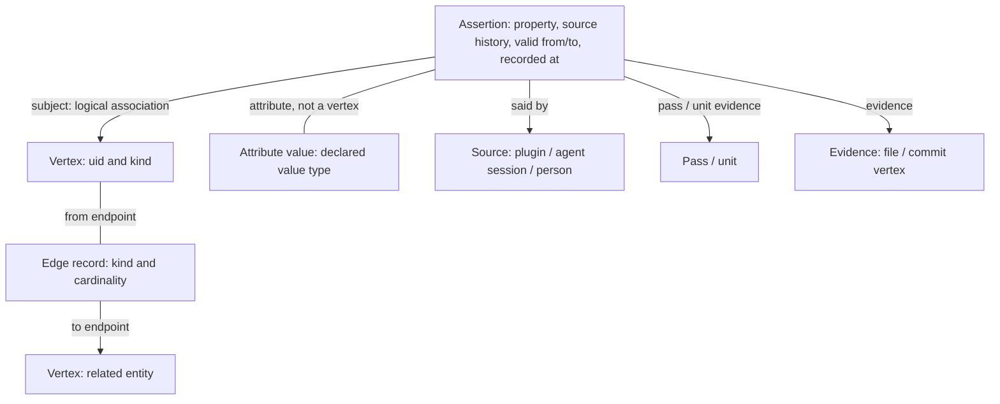
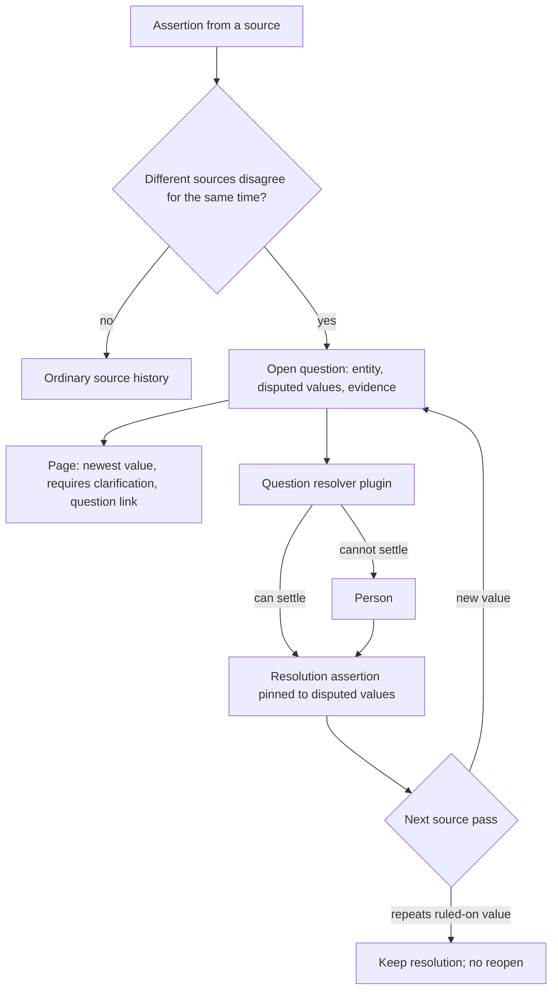

# 0039. The core graph: references as edges, typed values, one writer, system kinds and assertions per source

Status: proposed (records the owner's agreed direction; implementation and Open points remain)
Date: 2026-11-15
Task: madarch-64o5.137

Builds on 0027 (orchestration and pg-boss), 0028 (one graph), 0033 (one writer,
architecture checks and greenfield replacement), 0034 (identity and generated
per-kind storage), 0035 (plugins and their contracts) and 0036 (templates over
one GraphQL read API). The owner agreed the rules below on 2026-11-15. This is
a design record, not a claim that the running engine already enforces them.
Terms Reference, Value type, Synonym, System kind and Run are in the glossary.

Supersedes 0034 item 3: a reference is no longer an attribute column containing
a node id. Also replaces the conflicting parts of 0034 items 7, 8, 10 and 14,
0035's field-ownership/survivorship and private-result rules, and 0036 sections
2 and 3: assertions have source histories; corrections do not win forever;
relations come only from edges; a disputed value is newest, not null.
0027's unit drafts, private publication buffers and duplicate lease machinery
are replaced by immediate checked writes and pg-boss locking. This does not
silently specify their replacement crash/idempotency protocol; see Open.
0028's old temporal tables are not restored: time belongs to assertions here,
not to a second graph. Branch/worktree layers remain distinct from a unit draft.

## Context and problem

The 2026-11-15 audit found a structural breach of the graph-first design:

- The catalogue has no reference type with which to declare another entity.
  The audit counts 116 + 64 text references. Thirteen kinds have
  `repository: text`; other examples are a file's directory, added/removed
  commit, a gitlink's other repository, a table's database, an index's table
  and columns, a comment's subject, a link's ends and a practice's scope.
  These are relations concealed as scalar names, not graph edges.
- Nineteen tables hold data outside the graph. Runs, units, usage, control,
  drafts and the journal are treated as exceptions, so a person cannot ask
  about them through the same graph as the product's other entities.
- Readers compare strings instead of traversing relations. A repository page's
  file count can disagree with the files that actually belong to it.
- The agent's write path bypasses the kind/type check. Fixing the static
  plugins alone would leave another producer able to restore the same defect.

These are the audit's recorded facts, not a new measurement by this document.
The supplied comments on madarch-64o5.74 at 15:35–16:02 record the findings and
the owner's response: «Это же в корне неверно!» and «Но это еще хуже! У нас не
должно быть такого. Это нарушение наших архитектурных принципов.»

Earlier records left escape routes: 0034 item 3 stored references in columns;
0027 and 0035 staged unit results privately; 0028 exempted operational tables;
0036 computed reference relations from columns and returned null on a dispute.
The core must make violations impossible for a plugin, an agent and a person
alike, rather than ask each of them to remember the principle.

## Decision drivers

- Everything that is data is in the graph: «Все сущности у нас — вершины графа.
  Нам нужно это запретить, чтобы мы физически не могли нарушить это правило.»
  (madarch-64o5.74, 15:38/15:52).
- The same physical boundary applies to agents: «агентское заполнение тоже не
  должно нарушать это правило. Тоже нужно физическое ограничение.» (same).
- No unapproved exceptions: «Да, пусть отказывает. Доводим наш принцип до конца.
  Если понадобится отдельная таблица — эскалируй мне.» (same, 15:52).
- Strict declarations before chaos: «Давай лучше сразу пойдем по строгой схеме.
  Так будет проще потом справиться с хаосом.» (part 1).
- No duplicated mechanism: «если PG Boss это делает, зачем нам дублировать?»
  (part 5). No duplicated types or parent identity either (parts 1 and 2).
- Sources and disagreements stay visible. A person's old opinion is not more
  current merely because a person said it (parts 5d–5e).
- Two near-term outcomes, not exhaustive filling: see current architecture in
  the wiki from correct static and agent writes; give the development agent MCP
  tools to ask the graph what a change affects. «мы не стремимся с тобой сейчас
  заполнить весь граф целиком… по мере разработки, постепенно заполняли граф»;
  «от общего к частному» (madarch-64o5.137, 18:35).

Unless another task is named, “part” below means the core design walk recorded
on madarch-64o5.74, 2026-11-15. Times identify comments in the supplied transcript;
no tracker comment ids have been invented.

## Considered options

| Choice | Options discussed | Taken by the owner |
|---|---|---|
| Relations | Text identities; 0034's reference columns plus edges; all references as edges | Edges only; no transition or fallback |
| JSON | Forbid JSON; permit it with an optional schema; require a schema always | JSON allowed, JSON Schema mandatory for every JSON field and writer (part 1, refining 15:52) |
| Values | Make every value a vertex; duplicate field formats; reuse catalogue value types | Scalar/structured values stay attributes; one reusable type library |
| Identity | Repeat the repository in a file's scalar key; include the parent through a key edge | Parent edge plus the entity's own key fields (part 2) |
| Validation | Prompts/lints; generic values objects; generated schemas and one physical writer | Generated schemas at every door, writer checks graph-dependent constraints |
| System kinds | Product-controlled deletion; immutable built-ins with future inheriting extensions | Built-ins protected, engine updates and migrates them |
| Outside storage | Operational data as exceptions; owner-approved closed machinery list | Only graph storage, pg-boss, rebuildable caches, raw logs/traces |
| Unit results | Per-unit private context/draft; immediate accepted/refused writes | No unit draft (part 5, replacing the 16:02 draft-opinion proposal) |
| Control/leases | Hand-made lease/control tables; pg-boss plus a run's state machine | pg-boss locking/expiry/retries; run states for pause/stop |
| Ownership | One owner per field/edge kind; assertions per source with disputes | Part 5b's single-owner proposal gives way to parts 5d–5e's assertions; a source still cannot overwrite another source's statement |
| Reconciliation | Return lists for host publication; work with the graph and add/remove/update | Plugin uses the one writer; SDK shares reconciliation; read-only plugins cannot write |
| Survivorship | Source authority/seniority; null on disagreement; newest value | Newest with a dispute badge and question, no authority ranking by default |
| Change vs dispute | Treat all changed values as disputes; separate source history and cross-source disagreement | Same source changing is normal history; different sources disagreeing for the same time is a dispute |
| Resolution | Human first/always; resolver first; permanently overriding source values | Resolver first, person if unresolved; resolution pinned to the values judged |
| Duplicates | Merge same words across kinds; same-kind candidates only | Same-kind candidates; synonyms and provenance retained, unmerge possible |
| Names | Unique names; unique keys within kind and parent | Keys unique; same names allowed, kind labels distinguish them |
| Events | Every event a vertex; raw stream outside, durable outcomes in graph | Part 6: raw logs/events/traces outside with limited retention; results/statistics in graph |
| Delivery | Fill everything now; foundation then plugins then agents | Final assertion storage before lasting data; refill, no migration of today's products; onboarding deferred |

Wikidata, Datomic/XTDB and MDM were examples discussed, not selected dependencies.
The owner took match/merge, survivorship, quality and lineage ideas from MDM;
he later postponed onboarding/completeness work (madarch-64o5.137).

## Decision

### 1. A reference between entities is an edge, never a scalar field

Every reference is stored as an edge with declared end kinds. The `reference`
field type goes, rather than being introduced as another attribute type. The
one writer checks endpoints and their kinds; the store enforces declared edge
cardinality (a unique index for an exactly-one relation's uniqueness).
The catalogue check refuses a text field declared to hold another entity's
kind or identity. It reads declarations, not guesses from field names.
The disk, git and database-schema plugins publish edges, and all readers
traverse them; GraphQL derives relations and inverses only from edges, never
from an attribute column. No name-based fallback remains. A task's problem
reference in front JSON (madarch-64o5.104, PR #321) becomes a task → problem edge.

Owner: «Все сущности у нас — вершины графа. Нам нужно это запретить, чтобы мы
физически не могли нарушить это правило.»
Reference: madarch-64o5.74, 15:35, 15:38, 15:52 and 15:54. This supersedes
0034 item 3, including the column-derived relations in its schema outline.
Exactly-one also requires presence, not just uniqueness; the precise
transaction boundary enforcing its lower bound remains Open.

### 2. Identity uses the parent edge and the entity's own scalar key

A kind may declare a key edge to its parent plus its own fields: file =
repository edge + path; state = machine edge + name. The writer resolves an
entity by parent and own fields, refuses a child without its required parent,
and derives the child's uid from the parent's uid and its own key. It does
not repeat the parent's identity in the child's attributes. The edge kind
declares whether deleting a parent deletes its children or refuses the delete;
the writer/store apply that policy. Keys are unique within kind and parent,
not names globally.

Owner: «дублировать для сущности файл включать в уникальный ключ еще и
репозитории это значит нарушить нормальную форму базы поэтому наверное логично
что уникальный ключ должен состоять в том числе и из вершин ребер.»
Reference: madarch-64o5.74, 15:52; part 2, 17:53; names, 18:27.

### 3. Every field has a reusable value type; a value is not an entity

An attribute's value stays an attribute. Every field has a type from the
catalogue's shared value-type library, reusable across kinds and inside JSON
Schemas. The writer refuses a value that fails that type. A format may use a
regular expression declared in its value type; that is the only allowed
location. The no-regex gate admits those catalogue declarations and refuses
regexes in engine code; 0033's ban on regex-based source analysis stands.

Owner: «зачем мы будем дублировать? Мы же можем создать IP-адрес в одном
экземпляре… и там прописать его формат, а потом переиспользовать»;
«здесь для проверки регулярки можно использовать… IP-адрес через регуляр.
гораздо проще проверить».
Reference: madarch-64o5.74, part 1, 17:50. The earlier 16:02 suggestion that
value-set entries are vertices is not a decision to turn field values into
vertices; the boundary for value-set declarations is Open.

### 4. JSON is allowed only with its mandatory schema

Every JSON field always declares a JSON Schema, for every producer. The writer
refuses documents that do not fit it. JSON cannot become an untyped container
for entities or relations; references embedded in strings follow item 5.

Owner: «Json внутри точно будут нужны… Запрещать это было бы странно»;
«Давай лучше сразу пойдем по строгой схеме. Так будет проще потом справиться с
хаосом.» Reference: madarch-64o5.74, part 1, 17:50. This settles the 15:52
alternative “JSON goes, or only under a closed schema” in favour of schemas.

### 5. Mentions in text and JSON strings become edges

A uid token in text or a JSON string names a vertex. The one writer materialises
a `mentions` edge with its field path and refuses a token naming a missing
vertex. A plain entity name returns a hint, not a guessed relation. The same
mechanism covers every text write and strings nested inside JSON. Mentions
provide backlinks through the graph's inverse edges. The token syntax and
edge replacement details are Open, not decided here.

Owner: «Ну вообще эта ссылка называется?» — Reference (ru: ссылка), not pointer.
Reference: madarch-64o5.74, part 1, 17:50 (the agreed mechanism recorded with
this terminology); madarch-64o5.120, 18:27 and its task statement (unlinked
names returned to the agent, remaining ones visible to a person on the page).

### 6. Every entity has synonyms; ambiguous names show the kind

The system catalogue declares the common synonyms field on every entity. Names
plus synonyms form the hint/match dictionary. A name need not be unique. Search
shows “Payments — domain”; links and diagrams show “Payments (domain)” where
same-named entities meet; agent hints name every candidate with its kind. System
kinds declare en/ru labels like product kinds; templates show those labels,
not raw keys such as `manifest.kind`. An aggregate of catalogue kinds opens
their list; the template walk tests that raw kind keys do not leak into pages
or diagrams.

Owner: «для каждой сущности еще должны быть синонимы»;
«payments это может быть домен, и payments это может быть подсистема. Это же
разные вещи»; «Что это за manifest.kind?»
Reference: madarch-64o5.74, part 1, 17:50; part 5e, 18:26 and names agreement,
18:27; madarch-64o5.120, 18:27; madarch-64o5.114, 16:30.

### 7. Every door validates, including reads; one writer checks the graph

Input schemas for every MCP tool and API command are generated per kind from
the catalogue. No free `values` object is accepted. Reads as well as writes
refuse malformed input at the entry boundary. One writer for person, plugin
and agent checks what only the graph can establish: target existence, end
kinds, cardinality, parent/key and evidence. The fill agent's answer passes
through it too; no agent bypass remains. A refusal returns a code, field,
expected type and offending value. Architecture rules keep producers from
calling another write surface or directly storing facts.

Owner: «все MCP команды, все API команды от агента, они все должны валидировать
запрос обязательно»; «агентское заполнение тоже не должно нарушать это правило.
Тоже нужно физическое ограничение.»
Reference: madarch-64o5.74, part 3, 17:51; 15:38/15:52. Schema generation for
kind-independent commands and exact codes are Open.

### 8. All named data is in the graph, including the engine's own concepts

Runs, units, outcomes, agent usage, operations and their authors, fact histories,
problems, questions, tasks, decisions, settings, plugins, roles and permissions
are vertices/edges. The journal's author is an edge to a person. The engine
reads kinds, roles, permissions, states and workflows from the graph, never
hard-coded lists. At installation/first start it seeds its system catalogue,
roles/permissions, plugins, page templates, run state machine and workflows
(task, question, proposed kind). Their producer is `system` with madarch's
version, visibly shipped rather than personally authored. The architecture
gate refuses storage of these facts beside the graph and new hard-coded lists.
Raw telemetry is specifically excluded by item 11.

Owner: «Ну так все эти прогоны — это тоже сущность графа. У нас по идее вообще не
должно быть таблиц и данных за пределами графа.»; «все сущности, которые мы
используем в вики-движке на сервере, завести как сущности каталога и брать их из
графа … граф будет заполняться при установке нашими внутренними сущностями».
Reference: madarch-64o5.74, 15:52; madarch-64o5.114, 11:03.

### 9. System kinds cannot be deleted by a product

Run, unit, event, agent usage, operation, problem, person, role, plugin, setting
and kind are built-in system kinds shipped with the engine. The contract path
refuses a product's attempt to delete them. A future product extension inherits
the built-in kind; it does not replace its base contract. Engine upgrades update
these kinds and migrate their data. People's changes to system entities go
through the one writer as reversible assertions. On upgrade new system
assertions replace that source's old version; people's changes remain, and a
change to something they overrode is a dispute under items 15–17, not silent
erasure. The listed event kind does not require each raw event to be a vertex
(item 11).

Owner: «это должна быть системная часть, это встроенные типы, которые нельзя
удалить. Наверное их можно переопределить… но они все равно будут наследовать
тот исходный. Тем более, что при обновлении мы же должны эти внутренние типы
обновить… понадобится миграция данных, поэтому здесь нельзя отдавать на
растерзание каждый продукт.»
Reference: madarch-64o5.74, part 4, 17:55; madarch-64o5.114, 11:03 and 18:27.

### 10. CREATE TABLE has only the core installation and the manifest generator

Only graph-core installation DDL and the one generator reading the product
manifest create tables. System kinds use that same generator, not hand-written
run/unit/usage tables. The store schema and architecture check refuse data
outside the graph or approved machinery; a new exception is escalated to the
owner and is not added without his yes. pg-boss's own machinery is the declared
queue exception, not permission to add madarch-owned queue tables.

Owner: «Ну подожди, у нас же должен быть всего один create table, тот, который
создает таблицы при установке, при чтении манифеста продукта, правильно же?»;
«На схему таблиц тоже да, конечно»; «Если понадобится отдельная таблица —
эскалируй мне.» Reference: madarch-64o5.74, 16:02, agreeing the core/generator
proposal; 15:52. Exact generated assertion DDL is Open.

### 11. The outside-graph machinery list is closed

Only these remain outside:

- the graph's own storage tables;
- pg-boss's queue, with its locking, expiry and retries;
- caches rebuildable from the graph;
- raw event/log/trace streams, including debug logs, retained for a limited time.

Machinery holds no unique graph fact; a record can carry the uid of the run,
unit or vertex it serves. The architecture check refuses other tables and data
files. Run/unit results, what was done and not done, tools called and their
counts, token usage, problems and questions stay in the graph. A raw stream
record carries its run or unit uid. This final choice refines the earlier
15:52/16:02 inclusion of “events” among graph data.

Owner: «для логов уже есть отдельная таблица, и они там и останутся. Трейсы, логи,
режим отладки… обязательно должен быть. И это не повод все это писать в граф»;
«Мы должны записать его результаты… статистика по прогону. Что сделали, что не
сделали, какие результаты. Какие инструменты вызывали. Сколько токенов потратили».
Reference: madarch-64o5.74, part 5, 17:59 and part 6, 18:30. Retention duration
was not decided.

### 12. pg-boss owns leases; pause and stop are run states

Remove `fill_run_lease`, `fill_unit_lease` and the hand-made enqueue-stamp table;
pg-boss supplies job locking, expiry and retries. Remove `fill_control`: the
run vertex has its state machine, whose state the handler reads before each
step for pause and stop. A missing pg-boss capability, such as extending a
long agent job's expiry, goes to the owner; it never justifies another table
without his approval.

Owner: «конечно, нам не требуется дополнительная механика, если PG Boss это
делает, зачем нам дублировать? Вот если нам чего-то в нем не хватает, тогда
можно рассмотреть. И с этим приходи ко мне, чтобы таблицы не появлялись просто
так.»; «этот прогон… это на самом деле такая же вершина графа, как и все
остальное… свои атрибуты, свой статус, своя машина состояний».
Reference: madarch-64o5.74, part 5, 17:59; 16:02.

### 13. No per-unit draft: each write is accepted or refused immediately

Delete `fill_unit_draft` and `fill_unit_draft_part`. There is no private unit
context or draft assertion awaiting publication. Each unit write goes through
the one writer immediately and carries the unit as evidence. This replaces
the 16:02 draft-opinion idea and the private-results model of 0027/0035; it
is not a deletion of branch/worktree contexts. Existing guarantees against
late, duplicate and cancelled work need their concrete replacement protocol
specified before implementation (Open).

Owner: «Черновик единицы тем более не нужен. Мы либо принимаем создание
сущности, либо отказываем.»
Reference: madarch-64o5.74, part 5, 17:59.

### 14. Properties keep assertions per source, with time and graph lineage

Every property's values are assertions per source. Each source's history has
valid-from/to and recorded-at time. Who said it is an edge from the assertion
to its plugin, agent session or person; evidence is an edge to file/commit
vertices, with the pass visible in lineage. The writer validates those graph
references and evidence. A read can show every value's source, pass and evidence,
not string provenance hidden in a JSON blob. The foundation installs this final
storage shape, even while plugins initially supply one source per field.

Owner: «давай показывать самое новое значение, но при этом указывать, что требует
уточнения… плашку вешать. И ссылку на открытый вопрос.»
Reference: madarch-64o5.74, part 5d, 18:21 (agreed assertion shape recorded with
this quote), part 5e, 18:26 (lineage); madarch-64o5.137, 18:35 (final storage
before lasting data). Physical representation of assertions on edges is Open.

### 15. A source owns its statements, not the sole right to a property's truth

Part 5b first considered a single declared field/edge owner. Parts 5d–5e settle
the model as assertions per source, not a universal prohibition on a second
source's assertion. A producer cannot overwrite another source's statement.
A producer finding a field or edge outside its responsibility wrong files a
system question with its claim, evidence and edges to the entity and the
field/edge kind disputed. The writer's refusal of a non-owner overwrite names
that route. The question appears on the entity page and under «Ждёт вас»;
a dismissal or explicit correction is recorded, not a silent overwrite.
Precise permission to add a second source's assertion is Open.

Owner: «Если какой-то агент находит несоответствие в том поле, за которое он не
отвечает, он должен оформить это в виде открытого вопроса.»
Reference: madarch-64o5.74, part 5b, 18:02; refined by part 5d, 18:21–18:22.

### 16. Same-source change is history; cross-source disagreement is a dispute

A source giving a new value is an ordinary change: its old value enters that
source's history, without creating a question merely for the change. Different
sources giving different values for the same time open a question. The page
shows the newest value plus «требует уточнения» and a link to that question.
No authority ranking is the default. This replaces 0036's null-on-disagreement
value contract; related filters/sorts/aggregates need an explicit API follow-up
(Open), not the old rule silently left in place.

Owner: «давай показывать самое новое значение, но при этом указывать, что требует
уточнения… плашку вешать. И ссылку на открытый вопрос.»; «мнение человека,
которое было три месяца назад, оно не так важно, как мнение статического плагина,
который проанализировал только сейчас».
Reference: madarch-64o5.74, part 5d, 18:21; part 5e, 18:26.

### 17. A resolver tries first; resolutions bind the values they judged

The question resolver plugin tries to settle the dispute; what it cannot settle
goes to a person. A resolution is itself an assertion by the resolver or person,
pinned to the disputed values. Repeating a value already ruled on changes
nothing and reopens nothing. A new source value reopens the question and shows
that the earlier resolution judged old values. This qualifies item 16's normal
same-source-change rule when that source participates in a resolved dispute.
The next static pass cannot overwrite a settled answer just by repeating itself.

Owner: «Если может решить сам… исправляет сам. Если не может, то эскалирует
человеку»; «Не будет такого, что мы решили спор, а потом статически плагин просто
перезапишет то, что мы решили?»
Reference: madarch-64o5.74, part 5d, 18:21 and 18:22 (agreed pin-and-reopen
mechanism answering the latter question).

### 18. Every writing plugin reconciles add, remove and update through the writer

A plugin works with the graph, not a returned list for later host publication.
For its source/scope (such as repository at a commit), it reads its own facts,
compares them with the source, and explicitly adds what is missing, removes
what is gone and updates what changed, with evidence for every write. The SDK
implements this reconciliation once. The conformance kit plants an added,
removed and changed fixture item and refuses a writing plugin that fails any
of the three. The agent plugin has the same duty when its evidence changes.
This does not grant direct SQL access: “directly” means the one writer, within
0035's sandbox and capabilities. A plugin declaring itself read-only (export,
notification, read-only check) is exempt from reconciliation, but the writer
refuses every write from it.

Owner: «Плагин вообще не должен отдавать никакой список. Он работает
непосредственно с графом.»; «мы должны смотреть, чего не хватает… выявить, чего
больше нет или что лишнее… выявить изменения. Это три необходимые механики,
которые должны быть у любого плагина.»; «плагин должен реализовывать контракт…
Наверное, будут служебные плагины, у которых этих этапов не будет».
Reference: madarch-64o5.74, part 5c, 18:09 and follow-up, 18:13.

### 19. Vanished evidence is a visible problem

A mechanical consistency check marks a fact as a problem when its evidence
(file, blob, commit) no longer exists at the current revision. It is a safety
net beside producer reconciliation, not permission to retain stale facts
silently or to drop other sources' histories. The implementation must distinguish
historical evidence from evidence supporting a current fact (Open).

Owner: «выявить, чего больше нет или что лишнее… выявить изменения».
Reference: madarch-64o5.74, part 5c, 18:09 (the agreed mechanical safety net is
recorded with the reconciliation decision).

### 20. Find duplicate candidates within one kind; merge without losing sources

Names, synonyms and edges find candidate duplicate vertices of the same kind
and offer a merge. A merge retains the other name as a synonym and moves its
edges and assertions to the survivor. Unmerge can split them back because each
value keeps its source. Matching words in different kinds never qualify as
duplicates. The merge path enforces this kind boundary; no cross-kind merge
is inferred from a name. Approval/automation criteria are Open.

Owner: «все эти четыре надо взять и очень важно именно дубли и слияния»;
«Слияние будет происходить в синоним»; «payments это может быть домен, и payments
это может быть подсистема. Это же разные вещи».
Reference: madarch-64o5.74, part 5e, 18:26; names, 18:27. The survivor rule
replaces 0033 item 23's older new-identity merge rule for this operation.

### 21. Models are entities, not fields hiding another entity

State machines, states and transitions, processes/steps/gateways, activities,
sequences/interactions, classes/types and relations, components, ER/data models,
use cases and deployment views found in code or documents are entities of their
own kinds, with pages and drawn diagrams, not nested fields of another kind.
Known declarations are found by plugins, other cases by the agent. The catalogue
and writer enforce the same entity/edge boundary for these as for files.

Owner: «машины состояний, переходы, все эти диаграммы — диаграммы бизнес-процессов,
диаграммы активности … диаграмма последовательности, диаграмма классов … Это все
должно быть в виде отдельных сущностей. Если мы их обнаруживаем в коде, мы их
показываем.» Reference: madarch-64o5.114, 10:49.

### 22. Observability and gates land with the foundation

Every writer and plugin path has spans and logs. The database-tables page and
the physical/schema/architecture gates expose what the core stores; they are
part of the foundation, not optional follow-up work. Tests exercise refusals
through all producers, including the agent, and a filled fixture checks that
a repository's file totalCount equals its actual files. No fill is started by
writing this decision.

Owner: «Трейсы, логи, режим отладки… обязательно должен быть»; «Нам нужно это
запретить, чтобы мы физически не могли нарушить это правило.»
Reference: madarch-64o5.74, part 6, 18:30; 15:35/15:38;
madarch-64o5.137, 18:35 (agreed foundation contents).

### 23. Quality/completeness is agreed work, but not work to do now

Completeness by kind and product should be visible in the wiki; an onboarding
checklist should guide the person with ticks, with goals/maturity levels as
manifest data (madarch-wkne). This is deferred, not an acceptance condition of
the current core. No new completeness scoring formula is decided here.

Owner: «все эти четыре надо взять» (including data quality); «как в играх»;
then «онбординг пока отложить и сейчас не делать».
Reference: madarch-64o5.74, part 5e, 18:26; madarch-64o5.137, 18:35 (final order,
onboarding and completeness postponed).

## Storage in outline

This is a logical graph, not DDL. All boxes denote vertices, except the
explicit edge record and the attribute value. Arrows denote edges unless
labelled as a storage endpoint or attribute. The subject arrow denotes the
logical association; its physical representation is not selected here. Source
and evidence are vertices, not strings in assertion metadata. Whether assertions about an edge attach to
its record directly or through another declared mechanism is Open.

Generated storage must implement these identities, edges and assertions without
repeating references as scalar data. The outline deliberately does not choose
assertion table names, uid algorithms for assertions or time-range constraints.

## Dispute flow

The final arrow reopens the question with the old resolution marked as applying
to old values. A later new value can reopen a settled dispute even when it came
from the same source; normal source changes outside a settled dispute need no
question merely for being changes.

## Consequences

- One graph contains product and system facts; one generated contract drives
  storage, writer validation, MCP/API schemas and GraphQL relations. String
  comparisons and node-id reference columns disappear with their old readers.
- Assertions keep provenance and time even before multiple-source disputes are
  enabled. A second source and a newer static pass do not erase earlier history.
- Newest does not mean verified or accepted. The dispute remains visible and
  navigable until a resolver or person settles it.
- No unit staging storage remains. Crash safety, retries and cancellation must
  be designed for immediate writes before code; the old publication protocol
  cannot simply be copied with its draft tables renamed.
- Product contracts cannot remove system kinds. Installation data and updates
  use the graph; runtime lists do not become a second catalogue in code.
- Raw logs are disposable, durable outcomes are not. Statistics remain queryable
  after logs expire. No retention period, resolver confidence bound or merge
  threshold is introduced by this record.
- This redesign refills today's products with no data migration. That reset is
  distinct from future engine upgrades migrating protected system-kind data.
- This is writing only. No code, catalogue, glossary or product data is changed
  by this task; the glossary additions already on the base branch are reused.

## Agreed stage order

The order is recorded on madarch-64o5.137, 18:35, after parts 1–6. These are
implementation stages for this change, not a new fill-stage runtime.

1. **Foundation before lasting data.** This decision and glossary; value types;
   one writer with validation at every door; references as edges and parent
   keys; final per-source assertion storage with valid time and source/evidence
   edges; system kinds and only approved machinery; observability on every
   writer/plugin path, the database-tables page and gates. Refill products;
   migrate none of today's data. Settle implementation-blocking Open points
   before building their mechanisms.
2. **Plugins.** Bring plugins onto the shared add/remove/update reconciliation
   contract, initially one source per field with few disputes. Their output
   already uses the final assertion store, not a temporary schema.
3. **Agents.** Add disputes and the resolver, merge and mentions. Both static
   and agent filling must produce the correct graph, and MCP must let the
   development agent query and change it through the same guarded interfaces.
   Each later graph query uses what earlier steps learned, from general to
   particular; exhaustive filling is not the goal of this stage.

Onboarding/completeness (madarch-wkne) is postponed. No agent or fill is launched
as part of drafting or reviewing this record.

## Open

These are questions, not additional decisions. No numerical limit, fallback or
storage mechanism below has been silently selected.

1. **Immediate-write protocol.** How are retries, idempotency, cancelled/late
   workers, stale reads and unit completion fenced without a private draft?
   Which writes share a transaction, and what is a partially completed unit's
   visible state? How does this preserve the applicable 0027/0033 guarantees?
2. **Physical assertions and time.** What are assertion identity, key and
   generated storage? How are existence, edge assertions and edge attributes
   represented without making edges vertices (0034 item 5)? Which time chooses
   “newest” (valid or recorded), what breaks ties, and how do source histories
   compose with branch/worktree layers and removals? The owner chose valid
   from/to and recorded at, not a complete bitemporal DDL or overlap policy.
3. **Source authority and reconciliation scope.** How is a source authenticated
   and identified across plugin versions and agent sessions? Which declarations
   allow it to add assertions, versus require a question for a field it does
   not own? How are partial passes, source retractions, disabled producers and
   deletion of shared vertices handled? Parts 5b and 5d settle no complete
   permission protocol; reconciliation does not license erasing other sources.
4. **Resolution identity.** How are the exact ruled-on values pinned and matched
   on repetition? When does an identical value with new evidence count as new?
   What may the resolver settle automatically, and what evidence/authority must
   its resolution carry? How are duplicate/reopened questions identified?
5. **Edge contracts.** How are lower cardinality bounds enforced on immediate
   writes while creating a child and its required key edge? How are key-edge
   cycles, parent deletion choices and uid derivation encoded and validated?
   Unique indexes alone do not enforce the presence of an exactly-one edge.
6. **Structured values and mentions.** Which JSON Schema dialect and value-type
   reuse syntax apply? What is the uid-token syntax, field-path representation
   and escaping rule? How are stale mentions retracted, duplicate occurrences
   distinguished and plain-name hints returned/rendered? How are value-set
   declarations/entries modelled given the 16:02 vertex proposal and part 1's
   later rule that values are attributes?
7. **API contract after 0036.** What are the precise assertion/lineage and
   question response types? Do filters, ordering and aggregates use the newest
   value on a dispute? What becomes of the retained command reads for runs,
   settings, journal, usage and problems now that these are graph entities?
   How are schemas generated for tools not tied to one kind, and what are
   refusal codes? The graph-only direction is settled, route-by-route changes
   are not.
8. **System upgrades and effective values.** How do inheriting extensions and
   engine migrations preserve people's assertions? How does “people's changes
   stay on top” in madarch-64o5.114 compose with newest-by-default and pinned
   resolutions when a shipped assertion changes? Which durable event entities,
   if any, remain besides the raw stream and the named system event kind?
9. **Evidence validity.** Does “no longer exists at the current revision” mean
   a historical blob/commit is unavailable, or the current source stopped
   containing what it supported? How does the check distinguish valid history
   from a stale current assertion without incorrectly flagging old evidence?
10. **Merge/unmerge.** Who approves a candidate, what chooses the survivor, and
    how are key-edge identities, required relations and uniqueness reconciled?
    What records make moved edges and assertions reversible if the merged
    vertex is edited before unmerge? No match score or automatic-merge bound
    was agreed.
11. **Machinery enforcement and retention.** What exact table/file allowlist,
    generated-table recognition and architecture rules enforce the four allowed
    categories? What is the raw log/trace retention duration and cleanup policy?
    A pg-boss gap must return to the owner, not acquire a table by assumption.

## Sources and review boundary

The owner's words and agreements are the comments supplied for
madarch-64o5.74 (15:35–18:30, core walk parts 1–6 and follow-ups),
madarch-64o5.137 (18:35), madarch-64o5.120 (18:27), and
madarch-64o5.114 (10:49, 11:03, 15:52, 16:30, 18:27), all 2026-11-15.
Quoted Russian is preserved; the surrounding record is English. Earlier
records are context, not authority for an option the owner later replaced.
No independent agent review, implementation test, fill or rendered-diagram
acceptance is claimed by this draft.
