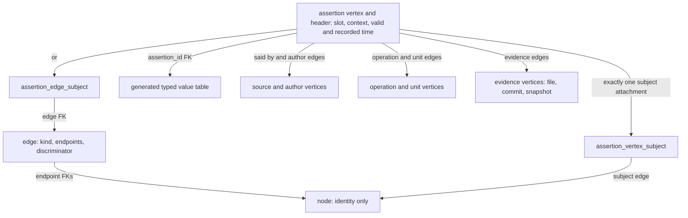
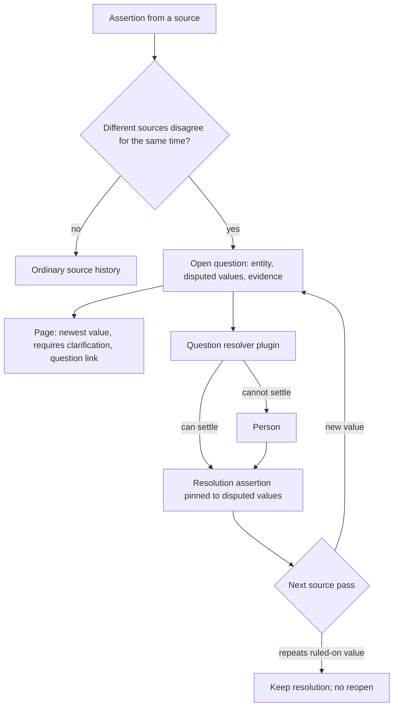

# 0039. The core graph: references as edges, typed values, one writer, system kinds and assertions per source

Status: proposed (owner decisions and engineering design recorded; implementation remains)
Date: 2026-11-15
Task: madarch-64o5.137

Builds on 0027 (orchestration and pg-boss), 0028 (one graph), 0033 (one writer,
architecture checks and greenfield replacement), 0034 (identity and generated
per-kind storage), 0035 (plugins and their contracts) and 0036 (templates over
one GraphQL read API). The owner agreed the rules below on 2026-11-15. This is
a design record, not a claim that the running engine already enforces them.
Terms Reference, Value type, Synonym, System kind and Run are in the glossary.

Supersedes 0034 item 3: a reference is no longer an attribute column containing
a node id. Also replaces the conflicting parts of 0034 items 7, 8, 10 and 14,
0035's field-ownership/survivorship and private-result rules, and 0036 sections
2 and 3: assertions have source histories; corrections do not win forever;
relations come only from edges; a disputed value is newest, not null.
0027's unit drafts, private publication buffers and duplicate lease machinery
are replaced by immediate checked writes and pg-boss locking. Their replacement crash/idempotency protocol is specified in item 24.
0028's old temporal tables are not restored: time belongs to assertions here,
not to a second graph. Branch/worktree layers remain distinct from a unit draft.

## Context and problem

The 2026-11-15 audit found a structural breach of the graph-first design:

- The catalogue has no reference type with which to declare another entity.
  The audit counts 116 + 64 text references. Thirteen kinds have
  `repository: text`; other examples are a file's directory, added/removed
  commit, a gitlink's other repository, a table's database, an index's table
  and columns, a comment's subject, a link's ends and a practice's scope.
  These are relations concealed as scalar names, not graph edges.
- Nineteen tables hold data outside the graph. Runs, units, usage, control,
  drafts and the journal are treated as exceptions, so a person cannot ask
  about them through the same graph as the product's other entities.
- Readers compare strings instead of traversing relations. A repository page's
  file count can disagree with the files that actually belong to it.
- The agent's write path bypasses the kind/type check. Fixing the static
  plugins alone would leave another producer able to restore the same defect.

These are the audit's recorded facts, not a new measurement by this document.
The supplied comments on madarch-64o5.74 at 15:35–16:02 record the findings and
the owner's response: «Это же в корне неверно!» and «Но это еще хуже! У нас не
должно быть такого. Это нарушение наших архитектурных принципов.»

Earlier records left escape routes: 0034 item 3 stored references in columns;
0027 and 0035 staged unit results privately; 0028 exempted operational tables;
0036 computed reference relations from columns and returned null on a dispute.
The core must make violations impossible for a plugin, an agent and a person
alike, rather than ask each of them to remember the principle.

## Decision drivers

- Everything that is data is in the graph: «Все сущности у нас — вершины графа.
  Нам нужно это запретить, чтобы мы физически не могли нарушить это правило.»
  (madarch-64o5.74, 15:38/15:52).
- The same physical boundary applies to agents: «агентское заполнение тоже не
  должно нарушать это правило. Тоже нужно физическое ограничение.» (same).
- No unapproved exceptions: «Да, пусть отказывает. Доводим наш принцип до конца.
  Если понадобится отдельная таблица — эскалируй мне.» (same, 15:52).
- Strict declarations before chaos: «Давай лучше сразу пойдем по строгой схеме.
  Так будет проще потом справиться с хаосом.» (part 1).
- No duplicated mechanism: «если PG Boss это делает, зачем нам дублировать?»
  (part 5). No duplicated types or parent identity either (parts 1 and 2).
- Sources and disagreements stay visible. A person's old opinion is not more
  current merely because a person said it (parts 5d–5e).
- Two near-term outcomes, not exhaustive filling: see current architecture in
  the wiki from correct static and agent writes; give the development agent MCP
  tools to ask the graph what a change affects. «мы не стремимся с тобой сейчас
  заполнить весь граф целиком… по мере разработки, постепенно заполняли граф»;
  «от общего к частному» (madarch-64o5.137, 18:35).

Unless another task is named, “part” below means the core design walk recorded
on madarch-64o5.74, 2026-11-15. Times identify comments in the supplied transcript;
no tracker comment ids have been invented.

## Considered options

| Choice | Options discussed | Taken by the owner |
|---|---|---|
| Relations | Text identities; 0034's reference columns plus edges; all references as edges | Edges only; no transition or fallback |
| JSON | Forbid JSON; permit it with an optional schema; require a schema always | JSON allowed, JSON Schema mandatory for every JSON field and writer (part 1, refining 15:52) |
| Values | Make every value a vertex; duplicate field formats; reuse catalogue value types | Scalar/structured values stay attributes; one reusable type library |
| Identity | Repeat the repository in a file's scalar key; include the parent through a key edge | Parent edge plus the entity's own key fields (part 2) |
| Validation | Prompts/lints; generic values objects; generated schemas and one physical writer | Generated schemas at every door, writer checks graph-dependent constraints |
| System kinds | Product-controlled deletion; immutable built-ins with future inheriting extensions | Built-ins protected, engine updates and migrates them |
| Outside storage | Operational data as exceptions; owner-approved closed machinery list | Only graph storage, pg-boss, rebuildable caches, raw logs/traces |
| Unit results | Per-unit private context/draft; immediate accepted/refused writes | No unit draft (part 5, replacing the 16:02 draft-opinion proposal) |
| Control/leases | Hand-made lease/control tables; pg-boss plus a run's state machine | pg-boss locking/expiry/retries; run states for pause/stop |
| Ownership | One owner per field/edge kind; assertions per source with disputes | Part 5b's single-owner proposal gives way to parts 5d–5e's assertions; a source still cannot overwrite another source's statement |
| Reconciliation | Return lists for host publication; work with the graph and add/remove/update | Plugin uses the one writer; SDK shares reconciliation; read-only plugins cannot write |
| Survivorship | Source authority/seniority; null on disagreement; newest value | Newest with a dispute badge and question, no authority ranking by default |
| Change vs dispute | Treat all changed values as disputes; separate source history and cross-source disagreement | Same source changing is normal history; different sources disagreeing for the same time is a dispute |
| Resolution | Human first/always; resolver first; permanently overriding source values | Resolver first, person if unresolved; resolution pinned to the values judged |
| Duplicates | Merge same words across kinds; same-kind candidates only | Same-kind candidates; synonyms and provenance retained, unmerge possible |
| Names | Unique names; unique keys within kind and parent | Keys unique; same names allowed, kind labels distinguish them |
| Events | Every event a vertex; raw stream outside, durable outcomes in graph | Part 6: raw logs/events/traces outside with limited retention; results/statistics in graph |
| Delivery | Fill everything now; foundation then plugins then agents | Final assertion storage before lasting data; refill, no migration of today's products; onboarding deferred |

Wikidata, Datomic/XTDB and MDM were examples discussed, not selected dependencies.
The owner took match/merge, survivorship, quality and lineage ideas from MDM;
he later postponed onboarding/completeness work (madarch-64o5.137).

## Decision

### 1. A reference between entities is an edge, never a scalar field

Every reference is stored as an edge with declared end kinds. The `reference`
field type goes, rather than being introduced as another attribute type. The
one writer checks endpoints and their kinds; the store enforces declared edge
cardinality (a unique index for an exactly-one relation's uniqueness).
The catalogue check refuses a text field declared to hold another entity's
kind or identity. It reads declarations, not guesses from field names.
The disk, git and database-schema plugins publish edges, and all readers
traverse them; GraphQL derives relations and inverses only from edges, never
from an attribute column. No name-based fallback remains. A task's problem
reference in front JSON (madarch-64o5.104, PR #321) becomes a task → problem edge.

Owner: «Все сущности у нас — вершины графа. Нам нужно это запретить, чтобы мы
физически не могли нарушить это правило.»
Reference: madarch-64o5.74, 15:35, 15:38, 15:52 and 15:54. This supersedes
0034 item 3, including the column-derived relations in its schema outline.
Exactly-one also requires presence, not just uniqueness; item 28 specifies
the atomic write and deferred lower-bound check.

### 2. Identity uses the parent edge and the entity's own scalar key

A kind may declare a key edge to its parent plus its own fields: file =
repository edge + path; state = machine edge + name. The writer resolves an
entity by parent and own fields, refuses a child without its required parent,
and derives the child's uid from the parent's uid and its own key. It does
not repeat the parent's identity in the child's attributes. The edge kind
declares whether deleting a parent deletes its children or refuses the delete;
the writer/store apply that policy. Keys are unique within kind and parent,
not names globally.

Owner: «дублировать для сущности файл включать в уникальный ключ еще и
репозитории это значит нарушить нормальную форму базы поэтому наверное логично
что уникальный ключ должен состоять в том числе и из вершин ребер.»
Reference: madarch-64o5.74, 15:52; part 2, 17:53; names, 18:27.

### 3. Every field has a reusable value type; a value is not an entity

An attribute's value stays an attribute. Every field has a type from the
catalogue's shared value-type library, reusable across kinds and inside JSON
Schemas. The writer refuses a value that fails that type. A format may use a
regular expression declared in its value type; that is the only allowed
location. The no-regex gate admits those catalogue declarations and refuses
regexes in engine code; 0033's ban on regex-based source analysis stands.

Owner: «зачем мы будем дублировать? Мы же можем создать IP-адрес в одном
экземпляре… и там прописать его формат, а потом переиспользовать»;
«здесь для проверки регулярки можно использовать… IP-адрес через регуляр.
гораздо проще проверить».
Reference: madarch-64o5.74, part 1, 17:50. The earlier 16:02 suggestion that
value-set entries are vertices is not a decision to turn field values into
vertices; the boundary for value-set declarations is specified in item 29.

### 4. JSON is allowed only with its mandatory schema

Every JSON field always declares a JSON Schema, for every producer. The writer
refuses documents that do not fit it. JSON cannot become an untyped container
for entities or relations; references embedded in strings follow item 5.

Owner: «Json внутри точно будут нужны… Запрещать это было бы странно»;
«Давай лучше сразу пойдем по строгой схеме. Так будет проще потом справиться с
хаосом.» Reference: madarch-64o5.74, part 1, 17:50. This settles the 15:52
alternative “JSON goes, or only under a closed schema” in favour of schemas.

### 5. Mentions in text and JSON strings become edges

A uid token in text or a JSON string names a vertex. The one writer materialises
a `mentions` edge with its field path and refuses a token naming a missing
vertex. A plain entity name returns a hint, not a guessed relation. The same
mechanism covers every text write and strings nested inside JSON. Mentions
provide backlinks through the graph's inverse edges. Item 29 specifies the token
syntax and edge replacement.

Owner: «Ну вообще эта ссылка называется?» — Reference (ru: ссылка), not pointer.
Reference: madarch-64o5.74, part 1, 17:50 (the agreed mechanism recorded with
this terminology); madarch-64o5.120, 18:27 and its task statement (unlinked
names returned to the agent, remaining ones visible to a person on the page).

### 6. Every entity has synonyms; ambiguous names show the kind

The system catalogue declares the common synonyms field on every entity. Names
plus synonyms form the hint/match dictionary. A name need not be unique. Search
shows “Payments — domain”; links and diagrams show “Payments (domain)” where
same-named entities meet; agent hints name every candidate with its kind. System
kinds declare en/ru labels like product kinds; templates show those labels,
not raw keys such as `manifest.kind`. An aggregate of catalogue kinds opens
their list; the template walk tests that raw kind keys do not leak into pages
or diagrams.

Owner: «для каждой сущности еще должны быть синонимы»;
«payments это может быть домен, и payments это может быть подсистема. Это же
разные вещи»; «Что это за manifest.kind?»
Reference: madarch-64o5.74, part 1, 17:50; part 5e, 18:26 and names agreement,
18:27; madarch-64o5.120, 18:27; madarch-64o5.114, 16:30.

### 7. Every door validates, including reads; one writer checks the graph

Input schemas for every MCP tool and API command are generated per kind from
the catalogue. No free `values` object is accepted. Reads as well as writes
refuse malformed input at the entry boundary. One writer for person, plugin
and agent checks what only the graph can establish: target existence, end
kinds, cardinality, parent/key and evidence. The fill agent's answer passes
through it too; no agent bypass remains. A refusal returns a code, field,
expected type and offending value. Architecture rules keep producers from
calling another write surface or directly storing facts.

Owner: «все MCP команды, все API команды от агента, они все должны валидировать
запрос обязательно»; «агентское заполнение тоже не должно нарушать это правило.
Тоже нужно физическое ограничение.»
Reference: madarch-64o5.74, part 3, 17:51; 15:38/15:52. Schema generation for
kind-independent commands and exact codes are specified in item 30.

### 8. All named data is in the graph, including the engine's own concepts

Runs, units, outcomes, agent usage, operations and their authors, fact histories,
problems, questions, tasks, decisions, settings, plugins, roles and permissions
are vertices/edges. The journal's author is an edge to a person. The engine
reads kinds, roles, permissions, states and workflows from the graph, never
hard-coded lists. At installation/first start it seeds its system catalogue,
roles/permissions, plugins, page templates, run state machine and workflows
(task, question, proposed kind). Their producer is `system` with madarch's
version, visibly shipped rather than personally authored. The architecture
gate refuses storage of these facts beside the graph and new hard-coded lists.
Raw telemetry is specifically excluded by item 11.

Owner: «Ну так все эти прогоны — это тоже сущность графа. У нас по идее вообще не
должно быть таблиц и данных за пределами графа.»; «все сущности, которые мы
используем в вики-движке на сервере, завести как сущности каталога и брать их из
графа … граф будет заполняться при установке нашими внутренними сущностями».
Reference: madarch-64o5.74, 15:52; madarch-64o5.114, 11:03.

### 9. System kinds cannot be deleted by a product

Run, unit, event, agent usage, operation, problem, person, role, plugin, setting
and kind are built-in system kinds shipped with the engine. The contract path
refuses a product's attempt to delete them. A product extension inherits
the built-in kind; it does not replace its base contract. Engine upgrades update
these kinds and migrate their data. People's changes to system entities go
through the one writer as reversible assertions. On upgrade new system
assertions replace that source's old version; people's inherited extensions
remain on top. Item 34 records the later decision: a broken extension holds
that kind at its prior contract and opens a problem, rather than silently
erasing the extension or activating an invalid contract. The listed event kind does not require each raw event to be a vertex
(item 11).

Owner: «это должна быть системная часть, это встроенные типы, которые нельзя
удалить. Наверное их можно переопределить… но они все равно будут наследовать
тот исходный. Тем более, что при обновлении мы же должны эти внутренние типы
обновить… понадобится миграция данных, поэтому здесь нельзя отдавать на
растерзание каждый продукт.»
Reference: madarch-64o5.74, part 4, 17:55; madarch-64o5.114, 11:03 and 18:27.

### 10. CREATE TABLE has only the core installation and the manifest generator

Only graph-core installation DDL and the one generator reading the product
manifest create tables. System kinds use that same generator, not hand-written
run/unit/usage tables. The store schema and architecture check refuse data
outside the graph or approved machinery; a new exception is escalated to the
owner and is not added without his yes. pg-boss's own machinery is the declared
queue exception, not permission to add madarch-owned queue tables.

Owner: «Ну подожди, у нас же должен быть всего один create table, тот, который
создает таблицы при установке, при чтении манифеста продукта, правильно же?»;
«На схему таблиц тоже да, конечно»; «Если понадобится отдельная таблица —
эскалируй мне.» Reference: madarch-64o5.74, 16:02, agreeing the core/generator
proposal; 15:52. Item 25 specifies the generated assertion storage.

### 11. The outside-graph machinery list is closed

Only these remain outside:

- the graph's own storage tables;
- pg-boss's queue, with its locking, expiry and retries;
- caches rebuildable from the graph;
- raw event/log/trace streams, including debug logs, retained for a limited time.

Machinery holds no unique graph fact; a record can carry the uid of the run,
unit or vertex it serves. The architecture check refuses other tables and data
files. Run/unit results, what was done and not done, tools called and their
counts, token usage, problems and questions stay in the graph. A raw stream
record carries its run or unit uid. This final choice refines the earlier
15:52/16:02 inclusion of “events” among graph data.

Owner: «для логов уже есть отдельная таблица, и они там и останутся. Трейсы, логи,
режим отладки… обязательно должен быть. И это не повод все это писать в граф»;
«Мы должны записать его результаты… статистика по прогону. Что сделали, что не
сделали, какие результаты. Какие инструменты вызывали. Сколько токенов потратили».
Reference: madarch-64o5.74, part 5, 17:59 and part 6, 18:30. The later
retention decision is recorded in item 33.

### 12. pg-boss owns leases; pause and stop are run states

Remove `fill_run_lease`, `fill_unit_lease` and the hand-made enqueue-stamp table;
pg-boss supplies job locking, expiry and retries. Remove `fill_control`: the
run vertex has its state machine, whose state the handler reads before each
step for pause and stop. A missing pg-boss capability, such as extending a
long agent job's expiry, goes to the owner; it never justifies another table
without his approval.

Owner: «конечно, нам не требуется дополнительная механика, если PG Boss это
делает, зачем нам дублировать? Вот если нам чего-то в нем не хватает, тогда
можно рассмотреть. И с этим приходи ко мне, чтобы таблицы не появлялись просто
так.»; «этот прогон… это на самом деле такая же вершина графа, как и все
остальное… свои атрибуты, свой статус, своя машина состояний».
Reference: madarch-64o5.74, part 5, 17:59; 16:02.

### 13. No per-unit draft: each write is accepted or refused immediately

Delete `fill_unit_draft` and `fill_unit_draft_part`. There is no private unit
context or draft assertion awaiting publication. Each unit write goes through
the one writer immediately and carries the unit as evidence. This replaces
the 16:02 draft-opinion idea and the private-results model of 0027/0035; it
is not a deletion of branch/worktree contexts. Item 24 replaces the guarantees against late, duplicate and cancelled work
with a concrete protocol, without another lease table.

Owner: «Черновик единицы тем более не нужен. Мы либо принимаем создание
сущности, либо отказываем.»
Reference: madarch-64o5.74, part 5, 17:59.

### 14. Properties keep assertions per source, with time and graph lineage

Every property's values are assertions per source. Each source's history has
valid-from/to and recorded-at time. Who said it is an edge from the assertion
to its plugin, agent session or person; evidence is an edge to file/commit
vertices, with the pass visible in lineage. The writer validates those graph
references and evidence. A read can show every value's source, pass and evidence,
not string provenance hidden in a JSON blob. The foundation installs this final
storage shape, even while plugins initially supply one source per field.

Owner: «давай показывать самое новое значение, но при этом указывать, что требует
уточнения… плашку вешать. И ссылку на открытый вопрос.»
Reference: madarch-64o5.74, part 5d, 18:21 (agreed assertion shape recorded with
this quote), part 5e, 18:26 (lineage); madarch-64o5.137, 18:35 (final storage
before lasting data). Item 25 specifies physical assertions on edges.

### 15. A source owns its statements, not the sole right to a property's truth

Part 5b first considered a single declared field/edge owner. Parts 5d–5e settle
the model as assertions per source, not a universal prohibition on a second
source's assertion. A producer cannot overwrite another source's statement.
A producer finding a field or edge outside its responsibility wrong files a
system question with its claim, evidence and edges to the entity and the
field/edge kind disputed. The writer's refusal of a non-owner overwrite names
that route. The question appears on the entity page and under «Ждёт вас»;
a dismissal or explicit correction is recorded, not a silent overwrite.
Item 26 specifies permission to add a second source's assertion.

Owner: «Если какой-то агент находит несоответствие в том поле, за которое он не
отвечает, он должен оформить это в виде открытого вопроса.»
Reference: madarch-64o5.74, part 5b, 18:02; refined by part 5d, 18:21–18:22.

### 16. Same-source change is history; cross-source disagreement is a dispute

A source giving a new value is an ordinary change: its old value enters that
source's history, without creating a question merely for the change. Different
sources giving different values for the same time open a question. The page
shows the newest value plus «требует уточнения» and a link to that question.
No authority ranking is the default. This replaces 0036's null-on-disagreement
value contract; item 30 changes filters, sorts and aggregates with it.

Owner: «давай показывать самое новое значение, но при этом указывать, что требует
уточнения… плашку вешать. И ссылку на открытый вопрос.»; «мнение человека,
которое было три месяца назад, оно не так важно, как мнение статического плагина,
который проанализировал только сейчас».
Reference: madarch-64o5.74, part 5d, 18:21; part 5e, 18:26.

### 17. A resolver tries first; resolutions bind the values they judged

The question resolver plugin tries to settle the dispute; what it cannot settle
goes to a person. A resolution is itself an assertion by the resolver or person,
pinned to the disputed values. Repeating a value already ruled on changes
nothing and reopens nothing. A new source value reopens the question and shows
that the earlier resolution judged old values. This qualifies item 16's normal
same-source-change rule when that source participates in a resolved dispute.
The next static pass cannot overwrite a settled answer just by repeating itself.

Owner: «Если может решить сам… исправляет сам. Если не может, то эскалирует
человеку»; «Не будет такого, что мы решили спор, а потом статически плагин просто
перезапишет то, что мы решили?»
Reference: madarch-64o5.74, part 5d, 18:21 and 18:22 (agreed pin-and-reopen
mechanism answering the latter question).

### 18. Every writing plugin reconciles add, remove and update through the writer

A plugin works with the graph, not a returned list for later host publication.
For its source/scope (such as repository at a commit), it reads its own facts,
compares them with the source, and explicitly adds what is missing, removes
what is gone and updates what changed, with evidence for every write. The SDK
implements this reconciliation once. The conformance kit plants an added,
removed and changed fixture item and refuses a writing plugin that fails any
of the three. The agent plugin has the same duty when its evidence changes.
This does not grant direct SQL access: “directly” means the one writer, within
0035's sandbox and capabilities. A plugin declaring itself read-only (export,
notification, read-only check) is exempt from reconciliation, but the writer
refuses every write from it.

Owner: «Плагин вообще не должен отдавать никакой список. Он работает
непосредственно с графом.»; «мы должны смотреть, чего не хватает… выявить, чего
больше нет или что лишнее… выявить изменения. Это три необходимые механики,
которые должны быть у любого плагина.»; «плагин должен реализовывать контракт…
Наверное, будут служебные плагины, у которых этих этапов не будет».
Reference: madarch-64o5.74, part 5c, 18:09 and follow-up, 18:13.

### 19. Vanished evidence is a visible problem

A mechanical consistency check marks a fact as a problem when its evidence
(file, blob, commit) no longer exists at the current revision. It is a safety
net beside producer reconciliation, not permission to retain stale facts
silently or to drop other sources' histories. The implementation must distinguish
historical evidence from evidence supporting a current fact (item 31).

Owner: «выявить, чего больше нет или что лишнее… выявить изменения».
Reference: madarch-64o5.74, part 5c, 18:09 (the agreed mechanical safety net is
recorded with the reconciliation decision).

### 20. Find duplicate candidates within one kind; merge without losing sources

Names, synonyms and edges find candidate duplicate vertices of the same kind
and offer a merge. A merge retains the other name as a synonym and moves its
edges and assertions to the survivor. Unmerge can split them back because each
value keeps its source. Matching words in different kinds never qualify as
duplicates. The merge path enforces this kind boundary; no cross-kind merge
is inferred from a name. The later approval decision and reversible records
are specified in item 32.

Owner: «все эти четыре надо взять и очень важно именно дубли и слияния»;
«Слияние будет происходить в синоним»; «payments это может быть домен, и payments
это может быть подсистема. Это же разные вещи».
Reference: madarch-64o5.74, part 5e, 18:26; names, 18:27. The survivor rule
replaces 0033 item 23's older new-identity merge rule for this operation.

### 21. Models are entities, not fields hiding another entity

State machines, states and transitions, processes/steps/gateways, activities,
sequences/interactions, classes/types and relations, components, ER/data models,
use cases and deployment views found in code or documents are entities of their
own kinds, with pages and drawn diagrams, not nested fields of another kind.
Known declarations are found by plugins, other cases by the agent. The catalogue
and writer enforce the same entity/edge boundary for these as for files.

Owner: «машины состояний, переходы, все эти диаграммы — диаграммы бизнес-процессов,
диаграммы активности … диаграмма последовательности, диаграмма классов … Это все
должно быть в виде отдельных сущностей. Если мы их обнаруживаем в коде, мы их
показываем.» Reference: madarch-64o5.114, 10:49.

### 22. Observability and gates land with the foundation

Every writer and plugin path has spans and logs. The database-tables page and
the physical/schema/architecture gates expose what the core stores; they are
part of the foundation, not optional follow-up work. Tests exercise refusals
through all producers, including the agent, and a filled fixture checks that
a repository's file totalCount equals its actual files. No fill is started by
writing this decision.

Owner: «Трейсы, логи, режим отладки… обязательно должен быть»; «Нам нужно это
запретить, чтобы мы физически не могли нарушить это правило.»
Reference: madarch-64o5.74, part 6, 18:30; 15:35/15:38;
madarch-64o5.137, 18:35 (agreed foundation contents).

### 23. Quality/completeness is agreed work, but not work to do now

Completeness by kind and product should be visible in the wiki; an onboarding
checklist should guide the person with ticks, with goals/maturity levels as
manifest data (madarch-wkne). This is deferred, not an acceptance condition of
the current core. No new completeness scoring formula is decided here.

Owner: «все эти четыре надо взять» (including data quality); «как в играх»;
then «онбординг пока отложить и сейчас не делать».
Reference: madarch-64o5.74, part 5e, 18:26; madarch-64o5.137, 18:35 (final order,
onboarding and completeness postponed).

### 24. Immediate writes are atomic operations, not atomic units

Engineering decision (madarch-64o5.137): use pg-boss's documented transactional
queue operations, retry count and active-job state, plus PostgreSQL row locks.
Why: queue delivery can repeat; a transaction and a fencing check, not a promise
of exactly-once execution, make each accepted operation occur once.

- A dispatched step has `(job id, attempt)` from pg-boss. The writer, never the
  plugin, obtains and verifies this pair against the active queue row under a
  lock in the same database transaction as the graph write. An expired,
  cancelled, completed or superseded attempt cannot write. The handler must
  use the supported pg-boss transaction interface; active state, retry count
  and expiry checks belong in that adapter, tested against the installed
  pg-boss version. A missing atomic capability blocks implementation and goes
  to the owner; it does not introduce another lease table.
- The writer also locks the run/unit graph state and checks it before every
  operation. Pause refuses further work until resumed; stop cancels future
  work. A stop and a write serialize on that lock: a write committed before
  stop remains visible; a later one is refused. No claim of rolling back a
  whole unit is made. Use database time to test expiry at acceptance; pg-boss
  must serialize retry/expiry transitions on the same job row lock.
- Every operation supplies an idempotency key stable across retries, scoped
  to the unit and logical operation (not to the attempt). An operation vertex
  holds the key, canonical request digest and result, with edges to its unit,
  author and affected facts. The writer locks the key. An identical retry
  returns that result without new assertions; different content under the
  same key is `IDEMPOTENCY_CONFLICT`. A stale worker cannot add anything; it
  may only read an already committed receipt. No enqueue-stamp table returns.
- One operation transaction contains its receipt, vertex/edge identities,
  assertions and retractions, lineage, mentions, key/cardinality checks,
  dispute/question changes and unit progress. All commit or none do. A batch
  creating interdependent entities is one operation. It is bounded by the API
  request limit, not an unbounded transaction lasting the unit's execution.
- Reads used to decide a mutation supply the graph revision and affected
  assertion/contract versions as preconditions. The writer locks affected
  subjects and keys in uid order and refuses stale preconditions with
  `REVISION_CONFLICT`; the producer rereads and replans, not blindly retries
  a changed decision. Serializable failures are retried with the same key.
- A partial unit is visible as `running`, `paused`, `failed` or `cancelled`,
  with committed operation count, last progress and remaining scope. Its
  accepted facts are visible immediately, linked to that unit. It is never
  labelled complete merely because some facts exist. Completion commits the
  terminal state, final counts, reconciliation completion and the transactional
  pg-boss completion/enqueue actions together. A crash before that transaction
  leaves a retryable unit; receipts prevent duplicated work. A crash after it
  leaves a completed unit. No queue payload is the sole copy of a durable fact.

### 25. Assertions are graph records with bitemporal, typed storage

Engineering decision (madarch-64o5.137), following Datomic's immutable datoms
and XTDB's valid/system time: keep statements append-only and derive the
current view. Why: correction of knowledge must not rewrite what was known
at an earlier time.

The graph core installs `node`, `edge`, `assertion`, `assertion_vertex_subject`
and `assertion_edge_subject`. Each assertion is itself a vertex of a system
assertion kind; its header is keyed by that vertex's local id and has property
slot, context, valid-from, valid-to, recorded-at, recorded sequence, and
operation (`assert` or `retract`). Exactly one subject attachment is required:
a graph edge to a vertex subject, or a core attachment with an FK to the edge
record for an edge subject. The latter is an edge-storage association, not an
entity-id string attribute and not an edge promoted to a vertex. Edge assertions
include edge existence and edge attributes; vertex existence is a declared
system property. Source, author, unit, operation and evidence are declared
edges from the assertion vertex. Thus assertions on edges have the same lineage
as assertions on vertices, while 0034's edge/vertex distinction remains.

The manifest generator creates typed assertion-value tables per vertex/edge
kind and property: `assertion_id` plus the declared scalar/structured value,
FKs and type checks. An existence assertion has a boolean value. A retraction
has no value row and names the source stream it retracts; it is not a global
delete. A value is never a vertex merely because it appears in a statement.
The generated schema contains no generic unvalidated JSON value bag. Typed
key indexes are rebuildable projections of these statements, not a second
source of facts. Local numeric FKs are physical storage references; API and
federation expose uids only.

Each assertion gets a UUIDv7 on its first accepted operation. The operation
receipt reuses it on retry. Valid intervals are half-open `[from, to)`; an
absent upper bound is infinity. Recorded-at and a strictly ordered database
recorded sequence are assigned by the writer, not accepted from a producer.
For an as-of read, first select statements recorded by the requested system
cutoff, then those covering the requested valid time. Within a source stream
(subject, property, language, context, source), the last recorded statement
wins on overlapping valid time; earlier statements remain queryable at older
system cutoffs. Retraction removes only that source's assertion from the view.
The writer defaults valid-from to acceptance time; imported historical facts
must explicitly supply their actual valid interval.

Across active source values, “newest” means greatest valid-from, then greatest
recorded sequence, then uid in code-point order for a deterministic final tie.
Recorded-at is explanatory clock time, not a tie breaker dependent on clock
precision. Future-valid statements do not win today's view. Equal typed values
agree even when their evidence differs. Different overlapping values are a
dispute; the selected value remains visible. A pinned resolution takes priority
only over the candidates it judged (item 27); inheriting contract overlays
(item 34) are applied before product-value survivorship.

Contexts still follow 0034's pinned parent layers. Resolve the nearest layer
for each source/property stream before selecting time and survivorship; an
explicit layer retraction masks that inherited stream, not another source.
Unchanged streams inherit from the pinned base. Existence retractions suppress
current traversal but retain identities, history and provenance. A global
entity removal is a separate authorised operation which validates every
source and relation; a producer's disappearance never implies global deletion.

### 26. Source identity is stable; executions and versions are lineage

Engineering decision (madarch-64o5.137), using W3C PROV's distinction between
agent, activity and entity. Why: a new execution or software version must not
manufacture a new independent opinion on each pass.

A source is a graph vertex for an installed producer identity and its declared
reconciliation scope. Plugin upgrades keep that uid; version, configuration,
pass and unit are lineage of a statement. A person's source is their stable
principal. Agent sessions are activities linked to the authenticated principal
and stable assigned producer/scope; sessions do not each become rival sources.
Distinct independently assigned agents may have distinct source identities.
Uninstall/reinstall preserves an explicitly retained identity; a genuinely new
producer gets a new identity and cannot impersonate the old one.

The host authenticates a capability binding principal, source uid, product,
context, scope, contract version and permitted kinds/properties/edge kinds.
The writer derives `saidBy` from it, never from a supplied string. The catalogue
permissions declare `assert`, `retract-own`, `resolve` and `merge` separately.
A second source may add its own assertion only with `assert` permission for
that slot/scope. An observer outside it may create a question with evidence,
not overwrite or add a competing statement through a broader generic endpoint.
No permission allows changing another source's historical record.

Reconciliation retracts only its own statements in the declared covered scope.
An interrupted/partial scan cannot treat unvisited records as absent. Explicit
retractions require checked evidence of absence; a sweep of unseen records is
allowed only after a successful complete scope scan, with its completion
marker and retractions committed atomically (or separate bounded, explicitly
completed subscopes). Disabling a producer records a state, not retractions.
Other sources' existence assertions keep a shared entity visible; history
and referenced identities are never physically garbage-collected by a plugin.

### 27. Resolution matching uses semantic candidates, not execution ids

Engineering decision (madarch-64o5.137), using MDM survivorship with W3C PROV
lineage. Why: a repeat observation must not undo a decision, but a changed
claim must not inherit approval it never received.

A question's identity is subject uid, property slot, context, language and the
overlapping valid-time segment. Adjacent segments with the same dispute may
share one question; a changed segment records a new revision of it. A candidate
fingerprint contains source uid, typed canonical value (or retraction), and
that valid segment. JSON uses RFC 8785 canonicalisation after schema validation;
reference sets sort uids by code point, ordered arrays retain order. Hashes
index candidates; matching also compares the canonical tuple, so a digest
collision is never treated as agreement.

The resolution vertex links the exact immutable assertions judged and records
their candidate fingerprints, chosen value, valid scope, rationale, evidence
and resolver/person principal. It does not rewrite source statements. Repeating
the same candidate with a new pass/evidence link still matches the resolution.
An evidence withdrawal or invalidity affecting the justification reopens it;
merely adding corroboration does not. A new source, changed value, retraction
or changed valid scope outside the pin reopens the same question with the old
resolution marked historical. A resolution superseding one records that edge.

An authorised resolver may settle when its evidence supports a definite answer
and all writer constraints hold; uncertainty produces a person-facing open
question. No source rank or invented numeric confidence threshold grants it
permission. Its resolution carries the same validated evidence and principal
as a person's, plus its run/session lineage.

### 28. Required edges and key identity are one checked write

Engineering decision (madarch-64o5.137), following relational deferred constraint
checking and Kubernetes API admission/versioned contracts. Why: valid objects
must be admitted as a whole, not exposed temporarily without required parents.

A create operation includes the entity, scalar key values and all required
edges; it can also include their newly created parents. Deferred constraint
triggers validate the transaction's final effective graph, including lower
bounds, upper bounds, endpoint kinds and key uniqueness. The writer takes
parent/key and cardinality locks, including on removals and competing sources;
constraints apply to the selected effective relations, with disputes visible.
Every individual source assertion still has valid endpoints and types. A
missing required relation refuses the whole transaction. A source may not
retract the last required edge unless it replaces it or retires the child in
the same operation. A partial unit never means a partially valid entity.

A manifest declares ordered scalar key fields, key-edge roles and for each
parent deletion either `restrict` or `cascade`; omission refuses the manifest.
Key-edge declarations must form a DAG; the manifest checker rejects cycles
and the writer refuses instance cycles. Cascade retires dependent current
existence/relations atomically, preserves history, and requires authority over
the affected scopes. Otherwise deletion refuses; it does not erase someone
else's assertion. Key changes create a new identity with an explicit relation,
not a mutable uid.

Engineering identity decision (madarch-64o5.137): use UUIDv7 for products,
keyless entities, source identities and operation/assertion ids; use UUIDv5
(namespace plus canonical key) for natural-key identities, as in 0034 with an
explicit federation scope. Why: UUIDv7 gives decentralised unique births;
UUIDv5 gives reproducible discovery of the same scoped natural key. Neither
clock order nor a local database sequence is an identity authority.

The UUIDv5 name is a versioned, length-delimited canonical tuple of kind-contract
uid, identity-scope uid, ordered key-edge role/target uid pairs and typed scalar
keys. Do not concatenate ambiguous strings. The scope is the parent uid for
parented kinds and product uid for product-local roots. Federated shared roots
(such as repositories) use a registry-declared global namespace and canonical
origin identity, never the discovering product uid or a mutable display URL.
Repository aliases point to that origin; copies across stores preserve the
same uid. Unknown equivalence is a merge candidate, not a guessed shared uid.
A keyless entity's uid travels with it; independently created similar ideas
remain distinct until merge. Import refuses a uid already bound to a different
identity. As with UUID practice generally, global uniqueness is the contract,
not a mathematical claim that random/hash collisions are impossible.

Owner: «потом планируется федерация. У каждого продукта будет свой сервер…
эти сервера друг с другом объединяются в федерацию… связи между продуктами»;
«У каждого продукта свой уникальный идентификатор, который потом не пересекается
ни с какими другими.» Reference: madarch-64o5.144, 19:23;
madarch-64o5.137, 19:23 (every entity as well as every product). Cross-server
transport and shared-store ownership remain federation work, not a new service
introduced by this record.

### 29. Structured values and mention tokens have one exact grammar

Engineering decision (madarch-64o5.137): JSON Schema Draft 2020-12, with
`$schema: https://json-schema.org/draft/2020-12/schema`. Why: a declared dialect
and versioned `$id`/`$ref` avoid validator-dependent contracts. Shared value
types publish immutable schema ids; fields reuse them by `$ref`. Resolve only
the installed catalogue registry, never fetch a remote schema during a write.
Enable format assertion consistently; reject unsupported vocabularies and
unresolved refs on contract installation. Apply `unevaluatedProperties: false`
where the contract is closed, not an implicit ban on declared extension maps.
Value-set and entry declarations are catalogue vertices with typed values and
labels; assigning such a scalar/enum value remains an attribute, not a relation.
An assignment that means an entity identity must instead declare an edge.

A mention token is exactly `[[uid:<uuid>]]`, where `<uuid>` is the lowercase
hyphenated UUID spelling used by the graph. A backslash before the opening
`[[` escapes the entire token; backslash itself escapes as `\\`. The shared
scanner consumes escapes left to right, in raw text and decoded JSON string
values (after JSON unescaping); malformed reserved tokens are validation
errors, not silently plain text. This is a small token grammar, not regex-based
source analysis. Missing targets refuse; cross-store unresolved targets are
not admitted until federation has a validated reference mechanism.

Each `mentions` edge belongs to the assertion that contains the string and
has an occurrence discriminator: RFC 6901 JSON Pointer to the field/string
plus zero-based Unicode code-point start and end offsets in the decoded
string. Repeated occurrences are distinct. Updating/retracting the source
assertion replaces its active mention set in the same transaction; historical
mentions remain with history. A plain name returns `hints` alongside the write
result: field path, span, candidates `{uid, kind, label, domain}`. It never
creates an edge. Templates show these suggestions and unresolved plain names
without inventing targets; ambiguous terms include the domain (item 35).

### 30. GraphQL and command contracts change together with 0036

Engineering decision (madarch-64o5.137), using Kubernetes versioned API schemas
and one declared read model. Why: changing storage must not leave an old read
surface with different truth-selection rules.

The following replaces 0036 section 2 and the column-derived parts of section 3;
its type naming, pagination, cost ceiling and per-page snapshot still apply:

- `<field>` returns the effective newest value from item 25, or null if absent,
  never null solely for disagreement. Filters, sorts, search indexing and
  aggregates use that same effective value in the same snapshot. `contested`
  still lists disputed slots; an explicit contested filter selects them.
  Counts and relation traversal use selected active existence/edges, not all
  historical candidates. Resolving a question can therefore change a result.
- Replace `<field>Opinions` with `<field>Assertions: [Assertion!]!`.
  `Assertion { id: ID!, subject: AssertionSubject!, property: String!,
  value: JSON, operation: AssertionOperation!, source: Entity!, author: Entity!,
  unit: Entity, validFrom: DateTime!, validTo: DateTime, recordedAt: DateTime!,
  evidence: [Evidence!]!, selected: Boolean!, question: Question }`.
  `AssertionSubject` is a union of vertex identity and `GraphEdge` (edge id,
  kind, from/to entities), not a fake entity for an edge. The JSON output value
  is validated by the slot schema; it is not a generic write input.
- `Evidence { target: Entity!, relation: String!, locator: JSON,
  validity: EvidenceValidity! }` links real vertices; a locator has a mandatory
  schema for spans/digests, never entity-id strings. `Question { id: ID!,
  state: QuestionState!, candidates: [Assertion!]!, resolution: Assertion,
  supersededResolutions: [Assertion!]! }`. A resolution assertion's lineage
  exposes its judged assertions and rationale through graph edges. Reserve
  these type/field names during manifest generation and reject collisions.
- Read selectors accept context, valid time and recorded cutoff; omitted times
  mean now and the transaction's recorded snapshot. Relations/inverses and
  backlinks are derived only from active edges. Lineage/history selectors
  explicitly request historical assertions, not a second read API.
- Runs, units, settings, journal, usage, problems and catalogue per-kind fill
  state are graph reads through `/graphql`. Remove their command read routes,
  including `/api/fill-runs`, when their graph replacement lands, with readers
  changed in the same work (madarch-64o5.140, 19:36, from .133). Commands for
  start/pause/stop and authorised settings changes remain commands through
  the writer; they return uids/operation results, not parallel page read models.
- Per-kind mutations use generated typed schemas. Multi-kind batch commands
  use a discriminated union of those schemas. Kind-independent graph commands
  have closed, versioned system-kind schemas for their selectors, preconditions
  and operation envelope; no unrestricted `values` write object returns.
  Publish the contract/schema revision in requests and responses. A mismatched
  contract is refused rather than coerced. No compatibility endpoint is kept.
- Refusals have `{code, path, expected, actual, retryable}`. Codes include
  `SCHEMA_INVALID`, `TARGET_MISSING`, `END_KIND_INVALID`, `CARDINALITY_INVALID`,
  `KEY_CONFLICT`, `SOURCE_FORBIDDEN`, `EVIDENCE_INVALID`, `CONTRACT_CONFLICT`,
  `REVISION_CONFLICT`, `ATTEMPT_STALE`, `RUN_NOT_WRITABLE` and
  `IDEMPOTENCY_CONFLICT`. Paths are JSON Pointers; secrets in actual values
  are redacted according to the field contract. The same codes reach MCP,
  plugins and people. Transport errors remain separate from refused writes.

### 31. Evidence can be historically valid and currently stale

Engineering decision (madarch-64o5.137), following W3C PROV derivation and XTDB
valid/system-time separation. Why: deleting a current file does not invalidate
that it existed at an earlier commit.

Evidence targets immutable commit/blob or content-snapshot vertices, linked to
file/repository vertices, with a typed span/digest locator. Historical validity
asks whether that target and span substantiate the statement at its valid time.
A missing local checkout of an otherwise identified historical commit is
`unavailable`, not proof of falsehood. A retention/fetch failure becomes a
provenance-availability problem, without rewriting history.

Current applicability separately asks whether the source still contains that
support at the product/context revision. A current assertion losing support is
marked stale with a problem linked to it and scheduled for reconciliation;
it is not silently erased. A validated source retraction ends its applicability.
An ended assertion's old evidence is not tested against today's tree. A span
whose digest contradicts its immutable target is invalid evidence and a refused
new write; later discovered corruption marks the existing statement and any
resolution depending on it as problematic. Reads expose historical validity,
current applicability and availability separately.

### 32. Merge follows the resolver rule and has a reversible journal

Owner: «по нашей стандартной механике сначала агент пытается, если он не уверен,
то эскалируется человеку. Точно такая же ситуация.»
Reference: madarch-64o5.143, 19:27; madarch-64o5.137, 19:27. Thus a confident,
authorised resolver merges; uncertainty becomes a question for a person.

Engineering decision (madarch-64o5.137), using MDM match/merge and survivorship.
Why: deduplication joins identities without discarding independent statements
or pretending later edits can be undone by a blind reverse update.

Only same-kind, compatible-scope entities qualify; glossary concepts also need
the same subject field. Prefer an already canonical/imported identity, otherwise
the earliest created identity, then code-point uid order. Preserve every losing
uid as an alias, never reuse it. The merge operation locks both equivalence
sets and affected keys, validates required relations, key conflicts and cycles,
and refuses conflicts requiring semantic judgement rather than guessing.
Distinct immutable natural keys remain alias identities with their own key
edges, not a mutated survivor key or duplicate canonical key row.

A merge vertex records actor, reason, evidence, members, survivor and operation
revision; edges link original assertions, redirected relations and aliases.
Original subject/endpoints and provenance stay in immutable history. The
current view redirects through the merge map, retains all source assertions
and adds losing labels as synonym assertions. It never copies a value while
throwing its original subject away.

Unmerge is a new operation linked to the merge, not deletion of the merge
record. It restores pre-merge memberships and endpoints, rechecks all contracts
and retains post-merge edits. Post-merge writes record the addressed alias and
merge revision; those unambiguously addressed to a member follow it back.
Writes addressed only to the survivor cannot be guessed onto the other member;
an ambiguous allocation or new uniqueness/cardinality conflict opens a question
and blocks unmerge until explicitly allocated. Thus reversibility retains
information even when automatic reversal is unsafe.

### 33. Retention and machinery are enforced, not conventions

Owner: «Это должно быть в настройках. В настройках этой конкретной машины.
Дефолты какие-то, конечно, должны быть. Пусть у нас очень подробные логи там
хранятся 3 дня. Можно ограничить еще по размеру, по возрасту. Ну, стандартная
практика.» Reference: madarch-64o5.140, 19:28; madarch-64o5.137, 19:28.

Debug logs and traces default to three days. Machine settings, not a product
manifest, define age and total-size limits; whichever limit is reached first
removes the oldest raw records first. The byte budget is an explicit machine
installation setting, not a guessed owner decision here. Durable results and
statistics remain graph data after cleanup. Machine settings themselves are
system setting vertices in the machine's graph scope; bootstrap supplies only
the pointer needed to open that store. Rotated files do not become an archive
with unlimited retention.

Engineering decision (madarch-64o5.137), following logrotate/journald bounds
and PostgreSQL schema privileges. Why: a closed list must constrain runtime
writes and schema changes as well as source code.

The permitted physical inventory is (a) graph-core DDL enumerated by its
migration version, including item 25's assertion attachments; (b) generated
kind/value/index tables exactly reproduced from installed contract uids and
versions; (c) the installed pg-boss version's schema and objects; (d) registered
rebuildable cache objects; (e) registered raw telemetry sinks/rotation paths.
No arbitrary table prefix grants admission. A generated inventory includes
columns, FKs, constraints and indexes; compare the actual schema to it and the
pg-boss migration inventory on startup and in CI. Unknown objects refuse normal
startup and produce a diagnostic naming schema/object and owning migration;
repair tools are explicit, not silent adoption.

Only the installer/generator database role has DDL rights. Producers have no
SQL credential; the writer role alone mutates graph facts. Cache and telemetry
adapters have access only to their registered objects/paths, with sandbox
confinement for plugins. CI rejects new DDL/file-write call sites outside these
adapters and verifies every registration's category and rebuild recipe or
retention policy. A cache may be deleted and rebuilt without losing unique
facts; the acceptance test proves that. The tables page reports inventory,
category, contract/migration and size. An unclassifiable table/file or a new
exception requires the owner's recorded approval, never an allowlist update
made merely to silence a gate. Queue payloads hold dispatch references, not
unique outcomes. Durable event entities mean decisions/transitions with an
effect on graph state; high-volume diagnostic occurrences stay raw telemetry.

### 34. System upgrades preserve a working inherited contract

Owner: «по стандартной практике у нас происходит автоматический апдейт. Правка,
которую делает человек, наследуется от нашей сущности. Если правка человека
перестает соответствовать контракту, или там требуется какая-то миграция, то
этот вопрос эскалируется в открытые проблемы и решается по тому же принципу.
Сначала агентом, потом человеком. Если агент в своих силах не уверен.»
Reference: madarch-64o5.137 and madarch-64o5.114, 19:30.
Owner: «если вот эта правка человека перестала соответствовать контракту, то мы
наверное должны продолжать пока работать по старому. То, которое было до
обновления.» Reference: madarch-64o5.114, 19:31.

An engine update automatically advances built-in kinds. A person's extension
inherits that base and stays on top; it is not an older rival source value to
be discarded by newest-value selection. Validate the proposed base, extension
and migration together before activation. A broken extension or migration
requiring resolution opens a problem, agent first, person when unsure. That
kind in that product keeps its previous working contract version; other kinds
advance. Keep the old engine contract available until its last held product
moves. Mutually dependent contract versions are validated together; never
activate a combination with an invalid cross-kind contract. This refines item
9's earlier general dispute rule; ordinary factual disagreements still follow
items 16–17.

Engineering decision (madarch-64o5.137), following Kubernetes API versioning and
admission: contract versions are immutable and an effective-version pointer
switches atomically with validated graph migrations. Why: readers and writers
must never disagree about which schema a held kind accepts. Old-version data
is not coerced into the new contract merely to complete an engine upgrade.

### 35. Catalogue identity and applicability follow product meaning

The following later owner choices constrain the core contracts, not a new fill
or catalogue implementation (madarch-64o5.144, 2026-11-15):

- Component is the C4 level between service/container and module; no separate
  subsystem kind. «Добавляй, конечно»; «классический С4 нам не подходит…
  недостаточно уровней…» (19:09). Domains, systems and components may recursively
  contain their own kind; diagrams use a node budget and show a higher grouping
  level when exceeded (arc42 recursive building blocks; budget UI is .77).
- Domains use all sources: «должны брать мы из любых источников. Наверное,
  сначала надо брать из документов, а потом это подтверждать в коде. Если
  документов нет, значит из кода» (19:10). Code-only inferences are proposals,
  not invented certainty; conflicting documents/code create a question. When
  evidence cannot answer: «значит мы должны открывать открытые вопросы и там
  спрашивать» (19:11).
- Bounded context stays: «давай оставлять, конечно» (19:12). First fill ties
  glossary concepts to domains. ISO 704/1087, SKOS and DDD's concept-per-context
  approach was accepted: «Да, принимаю так» (19:14). A concept is a vertex,
  definitions are attributes, domain/context are edges; names/synonyms are
  labels. Homonyms in different fields are distinct concepts, displayed with
  a field qualifier, not duplicates to merge across fields.
- «вид может быть пустым, с отметкой неприменимо… агент начинает какую-то
  сущность заполнять, он ищет, понимает, что здесь этого нет, и все, пишет
  неприменимо» (19:15). Applicability is a per-product/per-kind assertion with
  source and evidence of what was searched, not an invented instance. Later
  findings replace the same source's mark or dispute another's. It is distinct
  from not-yet-searched, failed and empty-but-applicable states.
- «Если у Kubernetes там еще дальше идут зависимые сущности, то мы уже все это
  дерево не заполним, оно для нас мертвое… сначала их определять» (19:17).
  The proposed implementation is a derived inapplicability assertion along
  `derives-from`, with an evidence edge to the ancestor mark, invalidated when
  that mark changes; a product profile under the product (deployment, stores,
  UI/mobile/ML/messaging, languages/frameworks) is filled first from static
  marker evidence. Linguist/Backstage-style detection explains why this avoids
  speculative searches. The supplied record explicitly calls this proposal
  “to confirm”; its approval remains Open below. A structural prerequisite
  relation is not itself proof that a whole branch is inapplicable.
- Systems/components relate to any number of domains, not one copy per domain:
  «Она относится и к биллингу, и к рассылкам» (19:18).
- Intent needs no repository: «У нас еще нет ничего, кроме идеи… Идея
  записывается в граф»; «Наша core-фича» (19:20). Product → idea → vision,
  research and requirements precede code. A dead idea keeps its state/reason;
  evolution to another idea is an edge within the product. Code later supplies
  implementation evidence. A repository can serve many products:
  «У нас может быть репозиторий с какими-то общими библиотеками» (19:21), with
  one identity and edges from products, not one identity per product.
- A task can exist without stage or feature: «Конечно, может» (19:23). Priority
  and queue position belong to work kinds; backlog is a view, not another
  “backlog item” entity. The owner referred back to his 2026-11-07 priority
  decision (19:25): owner sets level, agent proposes, WSJF by default is
  configurable; blockers inherit the blocked work's level. This is not a new
  queue mechanism in the core.

## Storage in outline

These are physical storage groups and their logical graph associations, not a
second graph. Local FKs implement storage endpoints. Assertion vertices have
ordinary source/evidence edges; edge subjects use the core FK attachment in
item 25 so edges never become vertices.



Generated tables, core tables, indexes and deferred constraints are inventoried
and checked by item 33. No source identity or evidence reference is encoded as
a free string inside a JSON value.

## Immediate-write sequence

```mermaid
sequenceDiagram
  participant Q as pg-boss
  participant H as Handler / producer
  participant W as One writer
  participant D as PostgreSQL graph and queue
  Q->>H: Dispatch job id and attempt
  H->>W: Operation key, typed batch, preconditions
  W->>D: BEGIN; lock job, run/unit, receipt key
  W->>D: Check active attempt, expiry, run state
  alt stale or stopped
    W->>D: ROLLBACK
    W-->>H: Refusal, no new facts
  else live attempt
    W->>D: Check receipt
    alt identical receipt exists
      W->>D: End transaction without changes
      W-->>H: Original result
    else new operation
      W->>D: Lock subjects/keys; check preconditions
      W->>D: Validate and write facts, lineage, receipt, progress
      W->>D: Deferred graph constraints; COMMIT
      W-->>H: Accepted result, visible immediately
    end
  end
  H->>W: Complete unit with stable completion key
  W->>D: BEGIN; repeat fencing and state checks
  W->>D: Final reconciliation, counts, terminal state, queue completion
  W->>D: COMMIT together
  W-->>H: Complete
```

Any validation/precondition failure in the new-operation branch rolls back all
its writes. A crash between operations leaves the earlier accepted facts visible
and the unit nonterminal. Retry repeats operations by key; it does not publish
a hidden unit buffer. A failed atomic pg-boss integration is an implementation
blocker, not permission to split the last transaction into unsafe commits.

## Dispute flow



The final arrow reopens the question with the old resolution marked as applying
to old values. A later new value can reopen a settled dispute even when it came
from the same source; normal source changes outside a settled dispute need no
question merely for being changes.

## Consequences

- One graph contains product and system facts; one generated contract drives
  storage, writer validation, MCP/API schemas and GraphQL relations. String
  comparisons and node-id reference columns disappear with their old readers.
- Assertions keep provenance and time even before multiple-source disputes are
  enabled. A second source and a newer static pass do not erase earlier history.
- Newest does not mean verified or accepted. The dispute remains visible and
  navigable until a resolver or person settles it.
- No unit staging storage remains. Crash safety, retries and cancellation use item 24;
  the old publication protocol is not copied with its draft tables renamed.
- Product contracts cannot remove system kinds. Installation data and updates
  use the graph; runtime lists do not become a second catalogue in code.
- Raw logs are disposable, durable outcomes are not. Statistics remain queryable
  after logs expire. Debug retention defaults to three days (item 33). No numeric resolver
  confidence bound or merge threshold is invented.
- This redesign refills today's products with no data migration. That reset is
  distinct from future engine upgrades migrating protected system-kind data.
- This is writing only. No code, catalogue, glossary or product data is changed
  by this task; the glossary additions already on the base branch are reused.

## Agreed stage order

The order is recorded on madarch-64o5.137, 18:35, after parts 1–6. These are
implementation stages for this change, not a new fill-stage runtime.

1. **Foundation before lasting data.** This decision and glossary; value types;
   one writer with validation at every door; references as edges and parent
   keys; final per-source assertion storage with valid time and source/evidence
   edges; system kinds and only approved machinery; observability on every
   writer/plugin path, the database-tables page and gates. Refill products;
   migrate none of today's data. Settle implementation-blocking Open points
   before building their mechanisms.
2. **Plugins.** Bring plugins onto the shared add/remove/update reconciliation
   contract, initially one source per field with few disputes. Their output
   already uses the final assertion store, not a temporary schema.
3. **Agents.** Add disputes and the resolver, merge and mentions. Both static
   and agent filling must produce the correct graph, and MCP must let the
   development agent query and change it through the same guarded interfaces.
   Each later graph query uses what earlier steps learned, from general to
   particular; exhaustive filling is not the goal of this stage.

Onboarding/completeness (madarch-wkne) is postponed. No agent or fill is launched
as part of drafting or reviewing this record.

## Open

Nothing is left for the owner in this record. The applicability cascade and
the first-filled product profile (madarch-64o5.144, 19:17) follow his words
«Если у Kubernetes там еще дальше идут зависимые сущности, то мы уже все это
дерево не заполним… нужно еще какие-то дополнительные корневые узлы добавить.
И сначала их определять.»; the engineering refinement — a derived mark cascades
only along declared applicability dependencies, with evidence naming the
inapplicable ancestor, never merely because a kind has a structural
prerequisite — is this record's design (madarch-64o5.145). The eleven original
engineering questions are decided in items 24–34; merge approval, system
upgrades and retention incorporate the later owner answers. No numerical
confidence threshold is needed to implement the standard «agent first, unsure →
person» rule.

## Sources and review boundary

The owner's words and agreements are the comments supplied for
madarch-64o5.74 (15:35–18:30, core walk parts 1–6 and follow-ups),
madarch-64o5.137 (18:35, 19:23–19:31), madarch-64o5.120 (18:27),
madarch-64o5.114 (10:49–19:31), madarch-64o5.143 (19:27),
madarch-64o5.140 (18:30, 19:28, 19:36) and madarch-64o5.144
(19:09–19:25), all 2026-11-15, including the supplied later-decision transcript.
Quoted Russian is preserved; the surrounding record is English. Where only an
English summary was supplied, it is not presented as a verbatim Russian quote.
Engineering choices in items 24–34 are this task's recorded design, not words
attributed to the owner. Earlier records cannot overrule his later decisions.

Named engineering practices (references, not selected runtime dependencies):

- [Datomic data model](https://docs.datomic.com/peer/whatis/data-model.html)
  and [XTDB temporal concepts](https://docs.xtdb.com/): immutable statements,
  valid time versus recorded knowledge.
- [pg-boss documentation](https://timgit.github.io/pg-boss/): jobs, retries,
  expiry and transactional use; the installed version must prove the atomic
  adapter required by item 24, including final completion.
- [JSON Schema Draft 2020-12](https://json-schema.org/draft/2020-12)
  and [RFC 8785](https://www.rfc-editor.org/rfc/rfc8785): explicit dialect and
  canonical JSON; [RFC 6901](https://www.rfc-editor.org/rfc/rfc6901): field paths.
- [W3C PROV-DM](https://www.w3.org/TR/prov-dm/): agents, activities, entities,
  derivation and attribution, without storing identity in free-form provenance.
- MDM match/merge and survivorship (for example
  [IBM MDM overview](https://www.ibm.com/think/topics/master-data-management)):
  source preservation, explicit survivor and reversible identity reconciliation.
- [Kubernetes API versioning](https://kubernetes.io/docs/reference/using-api/):
  schema admission and explicit contract versions, not silent coercion.
- [RFC 9562](https://www.rfc-editor.org/rfc/rfc9562): UUIDv5/UUIDv7, reproducible
  natural keys and decentralised births. ULID is an alternative, not a second
  id format mixed into this contract.
- [PostgreSQL constraints](https://www.postgresql.org/docs/current/sql-createtrigger.html):
  deferred constraint triggers and transactional enforcement;
  [journald limits](https://www.freedesktop.org/software/systemd/man/latest/journald.conf.html):
  age/size-bounded raw telemetry.

This is a writing-only design. No implementation test, fill, agent run or
rendered-diagram acceptance is claimed. Mermaid source is provided; visual
acceptance on the specified GitHub renderer remains unperformed in this box.
