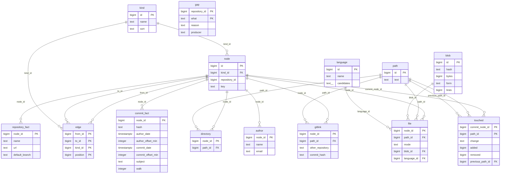
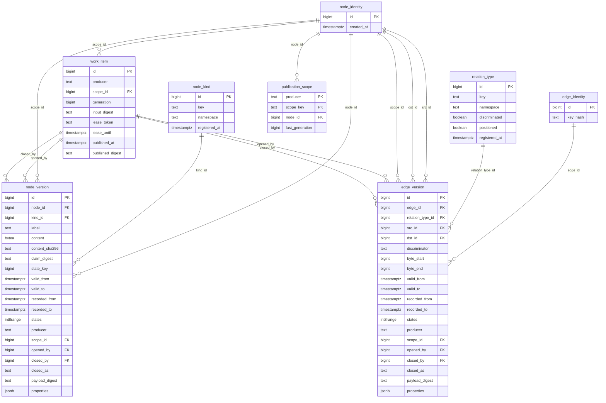
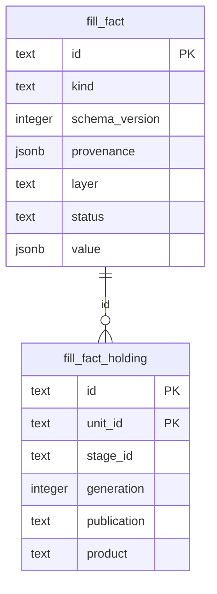

# The database as it is (2026-11-09)

Status: as-is description for the redesign the owner asked for on 2026-11-09
(«Давай перепроектируем … Ты можешь мне описать текущее состояние БД? Я посмотрю
визуально и мы перепроектируем с тобой»). Read from the demo product's PostgreSQL
18.6.1 cluster (madarch built from main at 04bcf331, products madarch and
madarch-demo filled once), read-only, by `pg_catalog` and `count(*)`. Nothing here
is the design to keep: the defects section lists what the redesign
(madarch-8bdc.2.11) removes. Every product has one such cluster, database
`madarch`, under `<madarch home>/products/.madarch/knowledge/<product id>/graph`.

## Overview

| Area | Tables | Rows | State |
|---|---:|---:|---|
| [The graph (src/graph/records.ts)](#graph) | 14 | 49 901 | written by the fill |
| [The temporal graph of decision 0028 (to delete)](#temporal) | 8 | 130 | dead, to delete |
| [The old fact store (to delete)](#facts) | 2 | 0 | dead, to delete |
| [The fill orchestrator (decision 0027)](#orchestrator) | 19 | 102 | written by the fill |
| [The job queue (pg-boss, schema pgboss)](#queue) | 12 | 14 | written by the fill |
| [Schema bookkeeping (schema madarch_meta)](#meta) | 1 | 4 | written at start |

## Defects the redesign removes

1. **Two graphs.** The fill writes the graph of `src/graph/records.ts`; the wiki's
   catalogue, entity pages and blocks read the temporal tables of decision 0028,
   which hold nothing. So every kind counts 0 and every page that showed relations
   is empty (madarch-8bdc.2.11).
2. **A vertex repeats its own attribute.** `node.key` repeats the identifying
   attribute of the kind table: a file's path (`file.path_id`), a commit's hash
   (`commit_fact.hash`, equal in every row), an author's email, a repository's
   name.
3. **A relation stored twice.** `node.repository_id` says which repository a
   vertex belongs to, and so do the `contains` edges; it is not even a foreign
   key, and the repository vertex names itself.
4. **An edge that is not an edge.** `kind` lists `touched` as an edge kind, but
   `touched` is a table naming a commit vertex and a *path*, not a file vertex.
   `blob` and `gitlink` are listed as vertex kinds; `blob` is a dictionary table
   with no vertex.
5. **The old fact store survives.** `fill_fact` and `fill_fact_holding` are still
   created though their code was to be deleted.
6. **No integrity in the orchestrator.** Nineteen `fill_*` tables reference each
   other by `run_id` and `unit_id` with no foreign key.
7. **Clusters outlive their servers.** On the demo machine four PostgreSQL
   clusters run, two of them for products whose servers were stopped hours ago.

<a id="graph"></a>

## The graph (src/graph/records.ts)

What the fill writes today: one vertex table, one edge table, a table of attributes per vertex kind, and dictionaries.



### `kind` — 12 rows

| Column | Type | Null |
|---|---|---|
| `id` | bigint |  |
| `name` | text |  |
| `sort` | text |  |

Constraints:

- `CHECK ((name <> ''::text))`
- `CHECK ((sort = ANY (ARRAY['node'::text, 'edge'::text])))`
- `PRIMARY KEY (id)`
- `UNIQUE (name)`

Sample rows:

```text
 id |    name    | sort 
----+------------+------
  1 | author     | node
  2 | blob       | node
  3 | commit     | node
  4 | directory  | node
  5 | file       | node
  6 | gitlink    | node
  7 | repository | node
  8 | as-is      | edge
  9 | authored   | edge
 10 | contains   | edge
 11 | parent     | edge
 12 | touched    | edge
(12 rows)
```

### `node` — 5 719 rows

| Column | Type | Null |
|---|---|---|
| `id` | bigint |  |
| `kind_id` | bigint |  |
| `repository_id` | bigint |  |
| `key` | text |  |

Constraints:

- `CHECK ((key <> ''::text))`
- `PRIMARY KEY (id)`
- `UNIQUE (repository_id, kind_id, key)`
- `FOREIGN KEY (kind_id) REFERENCES kind(id)`

Sample rows:

```text
  id  | kind_id | repository_id |                   key                    
------+---------+---------------+------------------------------------------
    1 |       7 |             1 | madarch
    2 |       3 |             1 | 04bcf3317972b6373b3d49e68dc0344403311a37
 2439 |       1 |             1 | person@example.com
 2447 |       5 |             1 | .architecture/violations.json
 4806 |       4 |             1 | .architecture
(5 rows)
```

### `edge` — 8 628 rows

| Column | Type | Null |
|---|---|---|
| `from_id` | bigint |  |
| `to_id` | bigint |  |
| `kind_id` | bigint |  |
| `position` | bigint |  |

Constraints:

- `PRIMARY KEY (from_id, to_id, kind_id, "position")`
- `FOREIGN KEY (from_id) REFERENCES node(id)`
- `FOREIGN KEY (to_id) REFERENCES node(id)`
- `FOREIGN KEY (kind_id) REFERENCES kind(id)`

Sample rows:

```text
 from_id | to_id | kind_id | position 
---------+-------+---------+----------
       1 |  4806 |      10 |        0
       1 |  4807 |      10 |        0
       2 |     3 |      11 |        0
    2439 |     2 |       9 |        0
       1 |     2 |       8 |        0
(5 rows)
```

### `repository_fact` — 2 rows

| Column | Type | Null |
|---|---|---|
| `node_id` | bigint |  |
| `name` | text |  |
| `url` | text |  |
| `default_branch` | text | yes |

Constraints:

- `CHECK ((name <> ''::text))`
- `PRIMARY KEY (node_id)`
- `FOREIGN KEY (node_id) REFERENCES node(id)`

Sample rows:

```text
 node_id |     name     |                                   url                                   | default_branch 
---------+--------------+-------------------------------------------------------------------------+----------------
       1 | madarch      | https://github.com/shady2k/madarch             | main
    5668 | madarch-demo | https://example.com/madarch-demo.git           | main
(2 rows)
```

### `directory` — 869 rows

| Column | Type | Null |
|---|---|---|
| `node_id` | bigint |  |
| `path_id` | bigint |  |

Constraints:

- `PRIMARY KEY (node_id)`
- `FOREIGN KEY (node_id) REFERENCES node(id)`
- `FOREIGN KEY (path_id) REFERENCES path(id)`

Sample rows:

```text
 node_id | path_id 
---------+---------
    4806 |    5077
    4807 |    5078
(2 rows)
```

### `file` — 2 399 rows

| Column | Type | Null |
|---|---|---|
| `node_id` | bigint |  |
| `path_id` | bigint |  |
| `mode` | text |  |
| `blob_id` | bigint |  |
| `language_id` | bigint |  |

Constraints:

- `CHECK ((mode = ANY (ARRAY['100644'::text, '100755'::text, '120000'::text])))`
- `PRIMARY KEY (node_id)`
- `FOREIGN KEY (node_id) REFERENCES node(id)`
- `FOREIGN KEY (path_id) REFERENCES path(id)`
- `FOREIGN KEY (blob_id) REFERENCES blob(id)`
- `FOREIGN KEY (language_id) REFERENCES language(id)`

Sample rows:

```text
 node_id | path_id |  mode  | blob_id | language_id 
---------+---------+--------+---------+-------------
    2447 |       1 | 100644 |       1 |           1
    2448 |     139 | 100644 |       2 |           2
(2 rows)
```

### `gitlink` — 0 rows

| Column | Type | Null |
|---|---|---|
| `node_id` | bigint |  |
| `path_id` | bigint |  |
| `other_repository` | text |  |
| `commit_hash` | text |  |

Constraints:

- `CHECK ((length(commit_hash) = 40))`
- `PRIMARY KEY (node_id)`
- `FOREIGN KEY (node_id) REFERENCES node(id)`
- `FOREIGN KEY (path_id) REFERENCES path(id)`

### `commit_fact` — 2 440 rows

| Column | Type | Null |
|---|---|---|
| `node_id` | bigint |  |
| `hash` | text |  |
| `author_date` | timestamp with time zone |  |
| `author_offset_min` | integer |  |
| `commit_date` | timestamp with time zone |  |
| `commit_offset_min` | integer |  |
| `subject` | text |  |
| `walk` | integer |  |

Constraints:

- `CHECK ((length(hash) = 40))`
- `CHECK ((walk >= 0))`
- `PRIMARY KEY (node_id)`
- `FOREIGN KEY (node_id) REFERENCES node(id)`

Sample rows:

```text
 node_id |                   hash                   |      author_date       | author_offset_min |      commit_date       | commit_offset_min |                          subject                           | walk 
---------+------------------------------------------+------------------------+-------------------+------------------------+-------------------+------------------------------------------------------------+------
       2 | 04bcf3317972b6373b3d49e68dc0344403311a37 | 2026-11-09 12:08:30+03 |               180 | 2026-11-09 12:08:30+03 |               180 | Merge pull request #228 from shady2k/feature/madarch-stack |    0
(1 row)
```

### `author` — 9 rows

| Column | Type | Null |
|---|---|---|
| `node_id` | bigint |  |
| `name` | text |  |
| `email` | text |  |

Constraints:

- `PRIMARY KEY (node_id)`
- `FOREIGN KEY (node_id) REFERENCES node(id)`

Sample rows:

```text
 node_id |  name  |       email        
---------+--------+--------------------
    2439 | Person | person@example.com
(sample redacted: authors are people)
```

### `touched` — 23 851 rows

| Column | Type | Null |
|---|---|---|
| `commit_node_id` | bigint |  |
| `path_id` | bigint |  |
| `change` | text |  |
| `added` | bigint | yes |
| `removed` | bigint | yes |
| `previous_path_id` | bigint | yes |

Constraints:

- `CHECK ((change = ANY (ARRAY['added'::text, 'modified'::text, 'deleted'::text, 'renamed'::text])))`
- `PRIMARY KEY (commit_node_id, path_id)`
- `FOREIGN KEY (commit_node_id) REFERENCES node(id)`
- `FOREIGN KEY (path_id) REFERENCES path(id)`
- `FOREIGN KEY (previous_path_id) REFERENCES path(id)`

Sample rows:

```text
 commit_node_id | path_id |  change  | added | removed | previous_path_id 
----------------+---------+----------+-------+---------+------------------
              2 |       1 | modified |     0 |     115 |                 
              2 |       2 | modified |     7 |       8 |                 
              2 |       3 | modified |     1 |       2 |                 
(3 rows)
```

### `blob` — 2 321 rows

| Column | Type | Null |
|---|---|---|
| `id` | bigint |  |
| `hash` | text |  |
| `bytes` | bigint |  |
| `form` | text |  |
| `lines` | bigint | yes |

Constraints:

- `CHECK ((length(hash) = 40))`
- `CHECK ((bytes >= 0))`
- `CHECK ((form = ANY (ARRAY['text'::text, 'binary'::text])))`
- `CHECK (((lines IS NULL) OR (lines >= 0)))`
- `CHECK (((form = 'binary'::text) = (lines IS NULL)))`
- `PRIMARY KEY (id)`
- `UNIQUE (hash)`

Sample rows:

```text
 id |                   hash                   | bytes  | form | lines 
----+------------------------------------------+--------+------+-------
  1 | cd9c58b50a536a38dca956eac4a96a62a3668f92 | 137285 | text |  5867
  2 | 673480ea4286896a32c2869db21cfd186621c741 |   3127 | text |    55
(2 rows)
```

### `path` — 3 620 rows

| Column | Type | Null |
|---|---|---|
| `id` | bigint |  |
| `text` | text |  |

Constraints:

- `PRIMARY KEY (id)`
- `UNIQUE (text)`

Sample rows:

```text
 id |                     text                      
----+-----------------------------------------------
  1 | .architecture/violations.json
  2 | AGENTS.md
  3 | docs/decisions/0032-agent-stage-for-people.md
(3 rows)
```

### `language` — 31 rows

| Column | Type | Null |
|---|---|---|
| `id` | bigint |  |
| `name` | text |  |
| `candidates` | text[] |  |

Constraints:

- `CHECK ((name <> ''::text))`
- `CHECK ((array_length(candidates, 1) >= 1))`
- `PRIMARY KEY (id)`
- `UNIQUE (name, candidates)`

Sample rows:

```text
 id |    name    |          candidates          
----+------------+------------------------------
  1 | ambiguous  | {JSON,OASv2-json,OASv3-json}
  2 | JavaScript | {JavaScript}
  3 | unknown    | {unknown}
  4 | Shell      | {Shell}
(4 rows)
```

### `gap` — 0 rows

| Column | Type | Null |
|---|---|---|
| `repository_id` | bigint |  |
| `what` | text |  |
| `reason` | text |  |
| `producer` | text |  |

Constraints:

- `CHECK ((what <> ''::text))`
- `CHECK ((reason = ANY (ARRAY['non-utf8-path'::text, 'shallow-history'::text, 'unreadable'::text])))`
- `CHECK ((producer = ANY (ARRAY['tree'::text, 'history'::text])))`
- `PRIMARY KEY (repository_id, what)`

<a id="temporal"></a>

## The temporal graph of decision 0028 (to delete)

Nothing writes these any more, and the wiki still reads them; every one is empty except its two dictionaries.



### `node_identity` — 0 rows

| Column | Type | Null |
|---|---|---|
| `id` | bigint |  |
| `created_at` | timestamp with time zone |  |

Constraints:

- `PRIMARY KEY (id)`

### `node_version` — 0 rows

| Column | Type | Null |
|---|---|---|
| `id` | bigint |  |
| `node_id` | bigint |  |
| `kind_id` | bigint |  |
| `label` | text |  |
| `content` | bytea | yes |
| `content_sha256` | text | yes |
| `claim_digest` | text | yes |
| `state_key` | bigint | yes |
| `valid_from` | timestamp with time zone |  |
| `valid_to` | timestamp with time zone |  |
| `recorded_from` | timestamp with time zone |  |
| `recorded_to` | timestamp with time zone |  |
| `states` | int8range |  |
| `producer` | text |  |
| `scope_id` | bigint |  |
| `opened_by` | bigint | yes |
| `closed_by` | bigint | yes |
| `closed_as` | text | yes |
| `payload_digest` | text |  |
| `properties` | jsonb |  |

Constraints:

- `CHECK ((producer <> ''::text))`
- `CHECK ((closed_as = ANY (ARRAY['correction'::text, 'cascade'::text])))`
- `CHECK ((payload_digest <> ''::text))`
- `CHECK ((valid_from < valid_to))`
- `CHECK ((recorded_from < recorded_to))`
- `CHECK (((state_key IS NULL) OR (state_key >= 0)))`
- `CHECK (((valid_from <> 'infinity'::timestamp with time zone) AND (recorded_from <> '-infinity'::timestamp with time zone) AND (recorded_from <> 'infinity'::timestamp with time zone)))`
- `CHECK (((NOT isempty(states)) AND (NOT lower_inf(states)) AND (NOT upper_inf(states)) AND (lower(states) >= 0)))`
- `CHECK (((recorded_to = 'infinity'::timestamp with time zone) = (closed_as IS NULL)))`
- `CHECK (((closed_by IS NULL) OR (closed_as IS NOT NULL)))`
- `CHECK (((content IS NULL) = (content_sha256 IS NULL)))`
- `CHECK (((content_sha256 IS NULL) OR (content_sha256 = encode(sha256(content), 'hex'::text))))`
- `CHECK (((claim_digest IS NULL) OR (length(claim_digest) = 64)))`
- `PRIMARY KEY (id)`
- `FOREIGN KEY (node_id) REFERENCES node_identity(id)`
- `FOREIGN KEY (kind_id) REFERENCES node_kind(id)`
- `FOREIGN KEY (scope_id) REFERENCES node_identity(id)`
- `FOREIGN KEY (opened_by) REFERENCES work_item(id)`
- `FOREIGN KEY (closed_by) REFERENCES work_item(id)`

### `node_kind` — 70 rows

| Column | Type | Null |
|---|---|---|
| `id` | bigint |  |
| `key` | text |  |
| `namespace` | text |  |
| `registered_at` | timestamp with time zone |  |

Constraints:

- `CHECK ((key <> ''::text))`
- `CHECK ((namespace = ANY (ARRAY['engine'::text, 'product'::text])))`
- `CHECK (((namespace = 'engine'::text) = (("left"(key, 7) = 'engine:'::text) OR ("left"(key, 5) = 'code.'::text))))`
- `PRIMARY KEY (id)`
- `UNIQUE (key)`

Sample rows:

```text
 id |        key        | namespace 
----+-------------------+-----------
  1 | engine:acceptance | engine
  2 | engine:answer     | engine
  3 | engine:claim      | engine
  4 | engine:content    | engine
(4 rows)
```

### `edge_identity` — 0 rows

| Column | Type | Null |
|---|---|---|
| `id` | bigint |  |
| `key_hash` | text |  |

Constraints:

- `CHECK ((length(key_hash) = 64))`
- `PRIMARY KEY (id)`
- `UNIQUE (key_hash)`

### `edge_version` — 0 rows

| Column | Type | Null |
|---|---|---|
| `id` | bigint |  |
| `edge_id` | bigint |  |
| `relation_type_id` | bigint |  |
| `src_id` | bigint |  |
| `dst_id` | bigint |  |
| `discriminator` | text |  |
| `byte_start` | bigint | yes |
| `byte_end` | bigint | yes |
| `valid_from` | timestamp with time zone |  |
| `valid_to` | timestamp with time zone |  |
| `recorded_from` | timestamp with time zone |  |
| `recorded_to` | timestamp with time zone |  |
| `states` | int8range |  |
| `producer` | text |  |
| `scope_id` | bigint |  |
| `opened_by` | bigint | yes |
| `closed_by` | bigint | yes |
| `closed_as` | text | yes |
| `payload_digest` | text |  |
| `properties` | jsonb |  |

Constraints:

- `CHECK ((producer <> ''::text))`
- `CHECK ((closed_as = ANY (ARRAY['correction'::text, 'cascade'::text])))`
- `CHECK ((payload_digest <> ''::text))`
- `CHECK ((valid_from < valid_to))`
- `CHECK ((recorded_from < recorded_to))`
- `CHECK (((valid_from <> 'infinity'::timestamp with time zone) AND (recorded_from <> '-infinity'::timestamp with time zone) AND (recorded_from <> 'infinity'::timestamp with time zone)))`
- `CHECK (((NOT isempty(states)) AND (NOT lower_inf(states)) AND (NOT upper_inf(states)) AND (lower(states) >= 0)))`
- `CHECK (((recorded_to = 'infinity'::timestamp with time zone) = (closed_as IS NULL)))`
- `CHECK (((closed_by IS NULL) OR (closed_as IS NOT NULL)))`
- `CHECK (((byte_start IS NULL) = (byte_end IS NULL)))`
- `CHECK (((byte_start IS NULL) OR ((byte_start >= 0) AND (byte_end > byte_start))))`
- `PRIMARY KEY (id)`
- `FOREIGN KEY (edge_id) REFERENCES edge_identity(id)`
- `FOREIGN KEY (relation_type_id) REFERENCES relation_type(id)`
- `FOREIGN KEY (src_id) REFERENCES node_identity(id)`
- `FOREIGN KEY (dst_id) REFERENCES node_identity(id)`
- `FOREIGN KEY (scope_id) REFERENCES node_identity(id)`
- `FOREIGN KEY (opened_by) REFERENCES work_item(id)`
- `FOREIGN KEY (closed_by) REFERENCES work_item(id)`

### `relation_type` — 60 rows

| Column | Type | Null |
|---|---|---|
| `id` | bigint |  |
| `key` | text |  |
| `namespace` | text |  |
| `discriminated` | boolean |  |
| `positioned` | boolean |  |
| `registered_at` | timestamp with time zone |  |

Constraints:

- `CHECK ((key <> ''::text))`
- `CHECK ((namespace = ANY (ARRAY['engine'::text, 'product'::text])))`
- `CHECK (((namespace = 'engine'::text) = (("left"(key, 7) = 'engine:'::text) OR ("left"(key, 5) = 'code.'::text))))`
- `PRIMARY KEY (id)`
- `UNIQUE (key)`

Sample rows:

```text
 id |        key         | namespace | discriminated | positioned 
----+--------------------+-----------+---------------+------------
  1 | engine:answers     | engine    | f             | f
  2 | engine:contradicts | engine    | f             | f
  3 | engine:evidence-of | engine    | f             | f
  4 | engine:state-after | engine    | f             | f
(4 rows)
```

### `publication_scope` — 0 rows

| Column | Type | Null |
|---|---|---|
| `producer` | text |  |
| `scope_key` | text |  |
| `node_id` | bigint |  |
| `last_generation` | bigint |  |

Constraints:

- `CHECK ((producer <> ''::text))`
- `CHECK ((scope_key <> ''::text))`
- `CHECK ((last_generation >= 0))`
- `PRIMARY KEY (producer, scope_key)`
- `FOREIGN KEY (node_id) REFERENCES node_identity(id)`

### `work_item` — 0 rows

| Column | Type | Null |
|---|---|---|
| `id` | bigint |  |
| `producer` | text |  |
| `scope_id` | bigint |  |
| `generation` | bigint |  |
| `input_digest` | text |  |
| `lease_token` | text |  |
| `lease_until` | timestamp with time zone |  |
| `published_at` | timestamp with time zone | yes |
| `published_digest` | text | yes |

Constraints:

- `CHECK ((producer <> ''::text))`
- `CHECK ((generation > 0))`
- `CHECK ((input_digest <> ''::text))`
- `CHECK ((lease_token <> ''::text))`
- `CHECK (((published_at IS NULL) = (published_digest IS NULL)))`
- `PRIMARY KEY (id)`
- `UNIQUE (producer, scope_id, generation)`
- `FOREIGN KEY (scope_id) REFERENCES node_identity(id)`

<a id="facts"></a>

## The old fact store (to delete)

The store PR #228 was to delete; its tables are still created, and empty.



### `fill_fact` — 0 rows

| Column | Type | Null |
|---|---|---|
| `id` | text |  |
| `kind` | text |  |
| `schema_version` | integer |  |
| `provenance` | jsonb |  |
| `layer` | text |  |
| `status` | text |  |
| `value` | jsonb |  |

Constraints:

- `PRIMARY KEY (id)`

### `fill_fact_holding` — 0 rows

| Column | Type | Null |
|---|---|---|
| `id` | text |  |
| `unit_id` | text |  |
| `stage_id` | text |  |
| `generation` | integer |  |
| `publication` | text |  |
| `product` | text | yes |

Constraints:

- `PRIMARY KEY (id, unit_id)`
- `FOREIGN KEY (id) REFERENCES fill_fact(id)`

<a id="orchestrator"></a>

## The fill orchestrator (decision 0027)

The run, its stages and units, their leases, drafts and publications, and the event log. No foreign key ties any of them together.

### `fill_run` — 1 rows

| Column | Type | Null |
|---|---|---|
| `run_id` | text |  |
| `product` | text |  |
| `state` | text |  |
| `context` | jsonb |  |
| `created_at` | bigint |  |
| `updated_at` | bigint |  |

Constraints:

- `PRIMARY KEY (run_id)`

Sample rows:

```text
          run_id          |   product    |   state   |  created_at   
--------------------------+--------------+-----------+---------------
 fill-20261109T091207935Z | madarch-demo | succeeded | 1794215528529
(1 row)
```

### `fill_run_configuration` — 1 rows

| Column | Type | Null |
|---|---|---|
| `run_id` | text |  |
| `digest` | text |  |
| `snapshot` | jsonb |  |
| `recorded_at` | bigint |  |

Constraints:

- `PRIMARY KEY (run_id)`

### `fill_run_stage` — 2 rows

| Column | Type | Null |
|---|---|---|
| `run_id` | text |  |
| `stage_id` | text |  |
| `planned_at` | bigint |  |
| `units` | integer |  |
| `publications` | integer |  |

Constraints:

- `PRIMARY KEY (run_id, stage_id)`

### `fill_unit` — 4 rows

| Column | Type | Null |
|---|---|---|
| `unit_id` | text |  |
| `product` | text |  |
| `stage_id` | text |  |
| `scope_key` | text |  |
| `generation` | integer |  |
| `created_at` | bigint |  |

Constraints:

- `PRIMARY KEY (unit_id)`
- `UNIQUE (product, stage_id, scope_key)`

Sample rows:

```text
                  unit_id                   |   product    |      stage_id      |        scope_key        | generation |  created_at   
--------------------------------------------+--------------+--------------------+-------------------------+------------+---------------
 repository-history/repository:madarch      | madarch-demo | repository-history | repository:madarch      |          1 | 1794215528539
 repository-history/repository:madarch-demo | madarch-demo | repository-history | repository:madarch-demo |          1 | 1794215528539
(2 rows)
```

### `fill_unit_plan` — 4 rows

| Column | Type | Null |
|---|---|---|
| `unit_id` | text |  |
| `generation` | integer |  |
| `run_id` | text |  |
| `stage_id` | text |  |
| `stage_unit_id` | text |  |
| `scope` | text |  |
| `stage_position` | integer |  |
| `plan_position` | integer |  |
| `planned_at` | bigint |  |
| `cache_versions` | jsonb | yes |

Constraints:

- `PRIMARY KEY (unit_id, generation)`

### `fill_unit_generation` — 4 rows

| Column | Type | Null |
|---|---|---|
| `unit_id` | text |  |
| `generation` | integer |  |
| `run_id` | text |  |
| `state` | text |  |
| `inputs_digest` | text |  |
| `fence` | integer |  |
| `context` | jsonb |  |
| `published_at` | bigint | yes |
| `stale_at` | bigint | yes |
| `updated_at` | bigint |  |

Constraints:

- `PRIMARY KEY (unit_id, generation)`

### `fill_unit_lease` — 4 rows

| Column | Type | Null |
|---|---|---|
| `unit_id` | text |  |
| `generation` | integer |  |
| `attempt` | integer |  |
| `fence` | integer |  |
| `holder` | text |  |
| `issued_at` | bigint |  |
| `expires_at` | bigint |  |
| `revoked_at` | bigint | yes |

Constraints:

- `PRIMARY KEY (unit_id, generation, attempt)`

### `fill_unit_draft` — 4 rows

| Column | Type | Null |
|---|---|---|
| `unit_id` | text |  |
| `generation` | integer |  |
| `digest` | text |  |
| `writes` | jsonb |  |
| `recorded_at` | bigint |  |
| `retracted_at` | bigint | yes |

Constraints:

- `PRIMARY KEY (unit_id, generation)`

### `fill_unit_draft_part` — 0 rows

| Column | Type | Null |
|---|---|---|
| `unit_id` | text |  |
| `generation` | integer |  |
| `part` | integer |  |
| `writes` | jsonb |  |

Constraints:

- `PRIMARY KEY (unit_id, generation, part)`

### `fill_unit_read` — 0 rows

| Column | Type | Null |
|---|---|---|
| `unit_id` | text |  |
| `generation` | integer |  |
| `query_digest` | text |  |
| `query` | text |  |
| `membership` | text |  |
| `members` | integer |  |
| `read_seq` | integer |  |
| `at` | bigint |  |

Constraints:

- `PRIMARY KEY (unit_id, generation, query_digest)`

### `fill_unit_split` — 0 rows

| Column | Type | Null |
|---|---|---|
| `parent_unit_id` | text |  |
| `parent_generation` | integer |  |
| `child_unit_id` | text |  |
| `child_generation` | integer |  |
| `sealed_at` | bigint |  |

Constraints:

- `PRIMARY KEY (parent_unit_id, parent_generation, child_unit_id)`

### `fill_publication` — 4 rows

| Column | Type | Null |
|---|---|---|
| `unit_id` | text |  |
| `generation` | integer |  |
| `digest` | text |  |
| `facts` | integer |  |
| `published_at` | bigint |  |

Constraints:

- `PRIMARY KEY (unit_id, generation)`

Sample rows:

```text
                unit_id                | generation |                              digest                              | facts | published_at  
---------------------------------------+------------+------------------------------------------------------------------+-------+---------------
 repository-history/repository:madarch |          1 | f284250b0d0ac2bcafa8de3460d2f6f9dc63a25115532a26d8e59db078310aea |     0 | 1794215531771
 repository-tree/repository:madarch    |          1 | 932ec94c53b64919fa9984c9de902f70d078dc6ab28ead6553918fd913a58a7f |     0 | 1794215532186
(2 rows)
```

### `fill_page_change` — 0 rows

| Column | Type | Null |
|---|---|---|
| `seq` | bigint |  |
| `node_id` | text |  |
| `unit_id` | text |  |
| `generation` | integer |  |
| `publication` | text |  |
| `product` | text | yes |

Constraints:

- `PRIMARY KEY (seq)`

### `fill_transition` — 33 rows

| Column | Type | Null |
|---|---|---|
| `seq` | bigint |  |
| `subject_kind` | text |  |
| `subject_id` | text |  |
| `generation` | integer | yes |
| `transition_id` | text |  |
| `from_state` | text |  |
| `to_state` | text |  |
| `event` | text |  |
| `fence` | integer | yes |
| `at` | bigint |  |

Constraints:

- `PRIMARY KEY (seq)`

### `fill_event` — 37 rows

| Column | Type | Null |
|---|---|---|
| `run_id` | text |  |
| `seq` | integer |  |
| `at` | bigint |  |
| `stage` | text |  |
| `unit_id` | text |  |
| `generation` | integer | yes |
| `kind` | text |  |
| `summary` | text |  |

Constraints:

- `PRIMARY KEY (run_id, seq)`

### `fill_control` — 0 rows

| Column | Type | Null |
|---|---|---|
| `run_id` | text |  |
| `action` | text |  |
| `at` | bigint |  |

Constraints:

- `PRIMARY KEY (run_id)`

### `fill_end` — 1 rows

| Column | Type | Null |
|---|---|---|
| `run_id` | text |  |
| `state` | text |  |
| `message` | text | yes |
| `unread` | jsonb | yes |
| `finished_at` | timestamp with time zone |  |

Constraints:

- `PRIMARY KEY (run_id)`

### `fill_chain` — 1 rows

| Column | Type | Null |
|---|---|---|
| `product` | text |  |
| `state` | text |  |
| `context` | jsonb |  |
| `updated_at` | bigint |  |

Constraints:

- `PRIMARY KEY (product)`

### `knowledge_fill` — 2 rows

| Column | Type | Null |
|---|---|---|
| `repo` | text |  |
| `scope` | text | yes |
| `head` | text |  |
| `commit_hash` | text |  |
| `effective_time` | text |  |
| `commits` | integer |  |
| `filled_commits` | integer |  |

Constraints:

- `PRIMARY KEY (repo)`

Sample rows:

```text
     repo     | scope |                   head                   |               commit_hash                |      effective_time      | commits | filled_commits 
--------------+-------+------------------------------------------+------------------------------------------+--------------------------+---------+----------------
 madarch      |       | 04bcf3317972b6373b3d49e68dc0344403311a37 | 04bcf3317972b6373b3d49e68dc0344403311a37 | 2026-11-09T09:12:12.364Z |    2437 |           2437
 madarch-demo |       | d5d4e5b5bf73b4c3ce41e5e23e073fbd45aad64c | d5d4e5b5bf73b4c3ce41e5e23e073fbd45aad64c | 2026-11-09T09:12:12.364Z |       3 |              3
(2 rows)
```

<a id="queue"></a>

## The job queue (pg-boss, schema pgboss)

A library's own schema; madarch adds one table to it.

| Table | Rows |
|---|---:|
| `instance` | 4 |
| `job_common` | 5 |
| `job_dependency` | 0 |
| `queue` | 2 |
| `queue_stats_20261109` | 0 |
| `queue_stats_20261110` | 0 |
| `schedule` | 0 |
| `subscription` | 0 |
| `version` | 1 |
| `warning` | 0 |
| `bam` | 0 |
| `madarch_enqueue_stamp` | 2 |

<a id="meta"></a>

## Schema bookkeeping (schema madarch_meta)

One stamp per module that created its tables.

### `schema_stamp` — 4 rows

| Column | Type | Null |
|---|---|---|
| `name` | text |  |
| `stamp` | text |  |
| `created_at` | timestamp with time zone |  |

Constraints:

- `PRIMARY KEY (name)`

